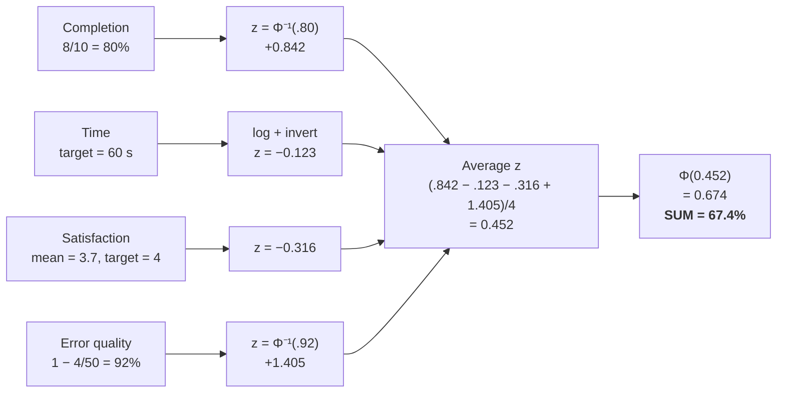
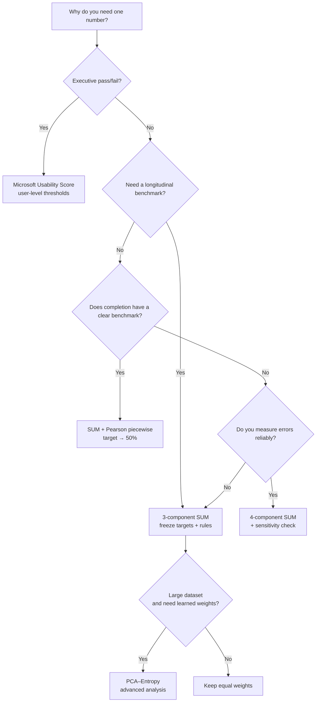

# Single Usability Metric: how to boil success, time and user impressions down to one number without fooling yourself

<!-- guide: {"kicker": "Research review", "curve": {"z": 0.452, "label": "Checkout example: SUM = 67.4%"}} -->

## Executive summary

**Single Usability Metric, or SUM**, tries to answer a very human question with one number: *"How usable is this product overall?"* Yet usability is made of at least several different things: did the person complete the task, how long did it take, how many mistakes did they make, and how satisfied were they. The original SUM was proposed by Jeff Sauro and Erika Kindlund in 2005 [[1](#ref-1)]. It built on the ISO/ANSI tradition of treating usability as **effectiveness, efficiency and satisfaction**, standardised heterogeneous metrics onto one scale and aggregated them. The original paper was published at CHI 2005, DOI 10.1145/1054972.1055028.

The strength of SUM is its simplicity at the level of a business decision. Seconds cannot be added directly to a 1–5 rating or to an 80% success rate, so each measure is converted into a **standardised distance from the desired level**, a z-score, and those standardised values can then be averaged. In the classic description, subjective ratings are compared with a target or specification limit; for time, a logarithm and a reference point such as `3 × expert time` were recommended; completion and error rate were turned into z-equivalents. The components were then averaged and the result converted back into a percentile.

But almost every one of these tidy-looking operations carries a hidden condition. In a large Microsoft programme (36 studies, almost 500 tasks, 13 platforms, about 800 users and more than 9,000 observations), the researchers found that errors are hard to code consistently, `3 × expert time` works poorly for very short and very long tasks, different Likert scales have different semantic thresholds, and the final normalised number can be harder to explain than the raw data. This is what led Van Waardhuizen, McLean-Oliver, Perry and Munko to an alternative **Usability Score**, described in *Explorations on Single Usability Metrics* at CHI 2019 [[10](#ref-10)].

The main conclusion of this lecture:

| Variant | What it aggregates | Main advantage | Main risk | Where I would use it |
|---|---|---|---|---|
| **Original 4-component SUM** | completion + errors + time + satisfaction | Follows the SUM idea most completely | Error rate and the time target can dominate and be unstable | When all four metrics have reliable rules fixed in advance |
| **3-component SUM** | completion + time + satisfaction | Much less noise from errors | The completion and time-target problems remain | A good baseline for repeated benchmarking |
| **Autodesk's practical adaptation** | success/completion + time + satisfaction, no errors; empirical targets | Targets can be tied to the real product | Targets depend on the benchmark design | Stable year-over-year benchmarks |
| **Microsoft Usability Score** | success AND perceived time AND ease AND satisfaction | Extremely easy to understand: "% of users for whom everything was good enough" | Hard thresholds, loss of gradation | Communication with stakeholders, product gates |
| **Pearson: Bernoulli correction** | fixes the SUM completion component | Makes the completion benchmark explicit | Singularities at 0/100%; a statistically debatable construction | Mainly sensitivity analysis |
| **Pearson: piecewise interpolation** | also calibrates completion against a benchmark | Simple, transparent, benchmark → exactly 50% | An artificial piecewise-linear scale | Practical SUM when the completion threshold matters |
| **PCA–Entropy SUM, 2026** | data-driven weighting of effectiveness/efficiency/satisfaction | The data structure sets the weights | Much more complex; the score becomes dataset-relative | Large multi-task benchmark programmes |
| **SUMA** | adds accessibility, learnability, flexibility, memorability and more | Widens the very notion of usability | Not yet as established a drop-in algorithm as classic SUM | A direction of development, especially for inclusive design |

> [!TIP]
> For most practical UX benchmarks I would choose the **3-component SUM without the automatic Six Sigma adjustment, and show the three components separately**. If it is critical that the completion benchmark, say 78%, maps to the neutral point of the composite score, I would add **Pearson's piecewise correction** as a rule fixed in advance. This is a synthesis, not a universal norm: Microsoft and Autodesk independently arrived at simplifying the error component [[7](#ref-7), [10](#ref-10)], and Pearson showed a separate problem with completion normalisation [[11](#ref-11)].

For executive reporting, where it matters more to say *"62% of users completed the task and also found it easy, fast and satisfying enough"* than to have a mathematically smooth index, the Microsoft variant will often be clearer than SUM.

> [!IMPORTANT]
> Finally, **one number should not replace diagnosis**. SUM is useful like the reading on a thermometer. But if the temperature is high, the doctor still wants to know the cause. So next to a single score you should always show completion, time and satisfaction separately; otherwise two completely different UX problems can produce the same SUM. This matters all the more given the communication difficulties Microsoft described after years of using the metric [[10](#ref-10)].


## The statistical minimum: what z-scores, normalisation, weights and aggregation actually do

Let us start not with formulas but with the problem.

Imagine three results for one task:

- completion rate = **80%**;
- mean time = **63 seconds**;
- satisfaction = **3.7 out of 5**.

You cannot write:

\[
0.80 + 63 + 3.7 = 67.5
\]

and call 67.5 usability. The units are different. It is like adding 5 kilometres to 7 degrees Celsius.

SUM first translates the measures into a **common, unitless language**.

### What a standard deviation is

Suppose ten people gave these satisfaction ratings:

\[
5,\;4,\;4,\;4,\;3,\;4,\;5,\;3,\;2,\;3.
\]

The mean:

\[
\bar{x}=3.7.
\]

But the mean alone is not enough. We need to know how spread out the answers are.

For our values, the sample standard deviation is:

\[
s\approx0.949.
\]

In plain words: **a typical rating sits about 0.95 points away from the mean**.

In Excel:

```excel
=AVERAGE(D2:D11)
```

and:

```excel
=STDEV.S(D2:D11)
```

Microsoft defines `STDEV.S` as an estimate of the standard deviation based on a sample; the standard deviation describes how widely values are dispersed around the mean.

### What a z-score is

The classic form:

\[
z=\frac{x-\mu}{\sigma}.
\]

In SUM we are often interested in a slightly different reading:

\[
z=\frac{\text{observed}-\text{target}}{SD}.
\]

For example, with a satisfaction target of 4:

\[
z_{sat}=
\frac{3.7-4}{0.949}
=
-0.316.
\]

Read it like this:

> [!NOTE]
> mean satisfaction is about **0.32 standard deviations below** the desired level.

There is no need to think of z as scary statistics. It is simply a universal ruler:

- `z = 0`: we are exactly on target;
- `z = +1`: one standard deviation better;
- `z = -1`: one standard deviation worse.

### Why z can be turned into a percentage

The standard normal distribution has a mean of 0 and a standard deviation of 1. The function \(\Phi(z)\), the normal cumulative distribution function, turns z into a number from 0 to 1. Excel's `NORM.S.DIST(z,TRUE)` does exactly that; `NORM.S.INV(p)` does the reverse, turning a percentile or probability into z.

For example:

\[
\Phi(0)=0.50.
\]

So `z=0` corresponds to the 50th percentile.

\[
\Phi(1)\approx0.8413.
\]

And `z=1` is about 84.1%.

In Excel:

```excel
=NORM.S.DIST(1,TRUE)
```

→ `0.841344746`.

Google Sheets also has functions for the standard normal distribution and its inverse, including `NORM.S.DIST` / `NORM.S.INV` and the legacy `NORMSDIST` / `NORMSINV`.

### Normalisation and standardisation are not quite the same

UX texts sometimes use these words loosely, but it helps to tell them apart:

**normalisation**: the general idea of bringing different measures onto a common scale;

**standardisation**: a specific way to do it, often through a z-score;

**percentile conversion**: turning z into a 0–1 scale through \(\Phi(z)\).

For example:

\[
3.7/5,\;63 \text{ sec},\;80\%
\]

after standardisation might become:

\[
-0.316,\;-0.123,\;+0.842.
\]

Now they can be aggregated mathematically.

### What weights mean

Equal weighting for three components:

\[
z_{SUM}=
\frac{z_1+z_2+z_3}{3}.
\]

This is the same as:

\[
z_{SUM}
=
0.333z_1+0.333z_2+0.333z_3.
\]

If completion matters more:

\[
z_{SUM}
=
0.50z_{completion}
+
0.25z_{time}
+
0.25z_{sat}.
\]

A weight literally answers the question:

> "What share of the vote does this metric get in forming the single number?"

Sauro and Kindlund used PCA to examine how the components relate to one another, and the original work supported aggregating them [[1](#ref-1)]; practical implementations often use equal weighting.

> [!IMPORTANT]
> But there is a fundamental point here: **equal weights do not mean equal actual influence**.
>
> If one z-score is `+3` and the others are `0.1` and `0.2`, the first component will still almost decide the result.

### Why time is log-transformed

Time on task almost always has a natural lower bound of 0, but it can have a long right tail: most people finish a task in 20–30 seconds, while one gets lost and spends 2 minutes.

For example:

\[
20,\;22,\;23,\;24,\;120.
\]

The arithmetic mean:

\[
41.8 \text{ s}.
\]

The geometric mean, which corresponds to averaging \(\ln(t)\):

\[
\approx31.1 \text{ s}.
\]

The logarithm does not "remove" the slow participant, but it makes their influence less destructive. The original SUM descriptions recommended a natural-log transformation of task time before standardisation.

In a spreadsheet:

```excel
=LN(C2)
```

and fill it down.

There are, however, two quite different versions of the z-score that must not be confused:

\[
z_{\text{target}}
=
\frac{x-target}{SD}
\]

answers the question *"how much better or worse are we than the requirement?"*;

\[
z_{\text{relative}}
=
\frac{x-\bar{x}}{SD}
\]

answers a different question: *"how much better or worse is this task than the average task in this dataset?"*

Classic SUM is mostly target-oriented for time and satisfaction; the new 2026 PCA–Entropy approach uses task-level z-normalisation relative to the sample mean [[14](#ref-14)]. This is an important difference in interpretation.


## The original SUM: formulas, a full example and a spreadsheet you can reproduce

The original SUM rests on four components:

\[
\text{Effectiveness}
\rightarrow
\begin{cases}
\text{Completion}\\
\text{Errors}
\end{cases}
\]

\[
\text{Efficiency}\rightarrow \text{Time on task}
\]

\[
\text{Satisfaction}\rightarrow\text{post-task ratings}.
\]

This structure matches the ISO tradition of looking at usability through effectiveness, efficiency and satisfaction; the current ISO 9241-11:2018 remains the applicable standard and defines its usability framework around the outcome of use in context.

In Microsoft's summary [[10](#ref-10)], the original SUM works like this: subjective metrics are compared with a spec limit of 4/5; task time is log-transformed, and the typical recommended spec limit was `expert time × 3` [[3](#ref-3)]; errors are divided by error opportunities; completion and error rate are turned into z-equivalents; the four components are averaged, and the aggregate z is converted back into a percentile.

### Our teaching dataset

Imagine a checkout test in an online shop.

An expert completes the task in about 20 seconds, so to illustrate the canonical rule:

\[
T_{spec}=20\times3=60s.
\]

Satisfaction target:

\[
S_{spec}=4/5.
\]

Suppose we also decided in advance that each participant has 5 opportunities to make an error.

| User | Success | Time, s | Satisfaction 1–5 | Errors | Error opportunities |
|---|---:|---:|---:|---:|---:|
| U1 | 1 | 42 | 5 | 0 | 5 |
| U2 | 1 | 50 | 4 | 0 | 5 |
| U3 | 1 | 55 | 4 | 1 | 5 |
| U4 | 1 | 60 | 4 | 0 | 5 |
| U5 | 1 | 64 | 3 | 0 | 5 |
| U6 | 1 | 72 | 4 | 1 | 5 |
| U7 | 1 | 78 | 5 | 0 | 5 |
| U8 | 1 | 85 | 3 | 1 | 5 |
| U9 | 0 | — | 2 | 1 | 5 |
| U10 | 0 | — | 3 | 0 | 5 |

> [!WARNING]
> In this example the time component is computed over those who completed the task. This must be a **rule fixed in advance**: excluding failures from time creates survivor bias, which we will come back to.

#### Completion

\[
p_c=\frac{8}{10}=0.80.
\]

For completion, the original logic does not compute:

\[
\frac{0.80-0.78}{SD}.
\]

Instead, the proportion is converted into its standard-normal equivalent:

\[
z_c=\Phi^{-1}(0.80)=0.8416.
\]

Excel:

```excel
=NORM.S.INV(AVERAGE(B2:B11))
```

Result:

```text
0.841621
```

This particular feature later becomes the target of Pearson's critique.

#### Time on task

Take natural logs:

| t | ln(t) |
|---:|---:|
| 42 | 3.7377 |
| 50 | 3.9120 |
| 55 | 4.0073 |
| 60 | 4.0943 |
| 64 | 4.1589 |
| 72 | 4.2767 |
| 78 | 4.3567 |
| 85 | 4.4427 |

Mean log time:

\[
\overline{\ln(t)}=4.1233.
\]

Sample SD:

\[
SD_{\ln(t)}=0.2357.
\]

Target:

\[
\ln(60)=4.0943.
\]

Because **less time is better**, the sign has to be oriented so that "higher z = better":

\[
z_t=
\frac{\ln(T_{spec})-\overline{\ln(t)}}{SD_{\ln(t)}}.
\]

That is:

\[
z_t=
\frac{4.0943-4.1233}{0.2357}
=
-0.1228.
\]

On average our users are a little slower than the target.

In `G2`:

```excel
=IF(B2=1,LN(C2),NA())
```

and the summary:

```excel
=(LN(60)-AVERAGE(FILTER(G2:G11,B2:B11=1)))/
 STDEV.S(FILTER(G2:G11,B2:B11=1))
```

The Autodesk case study also stresses separately [[7](#ref-7)] that the sign of the time metric must be inverted, because less time means better UX, while for satisfaction and completion higher values are better.

#### Satisfaction

We have:

\[
\bar{S}=3.7
\]

and:

\[
SD_S=0.9487.
\]

Target = 4:

\[
z_s=
\frac{3.7-4}{0.9487}
=
-0.3162.
\]

Excel:

```excel
=(AVERAGE(D2:D11)-4)/STDEV.S(D2:D11)
```

#### Errors

In total:

\[
E=4.
\]

Error opportunities:

\[
50.
\]

Error rate:

\[
r_e=\frac{4}{50}=0.08.
\]

But more errors = worse, so we first turn it into a "quality rate":

\[
q_e=1-r_e=0.92.
\]

Then:

\[
z_e=\Phi^{-1}(0.92)=1.4051.
\]

Excel:

```excel
=1-SUM(E2:E11)/SUM(F2:F11)
```

→ `0.92`

and:

```excel
=NORM.S.INV(0.92)
```

→ `1.405072`.

The inversion of error rate as `1-error rate` is discussed in detail in the practical Autodesk case study.

#### Aggregation

We now have:

| Component | z |
|---|---:|
| Completion | +0.8416 |
| Time | −0.1228 |
| Satisfaction | −0.3162 |
| Error quality | +1.4051 |

Equal-weight aggregate:

\[
z_{SUM}
=
\frac{0.8416-0.1228-0.3162+1.4051}{4}
=
0.4519.
\]

Spreadsheet:

```excel
=AVERAGE(z_completion,z_time,z_satisfaction,z_error)
```

Converting back:

\[
SUM=\Phi(0.4519)=0.6743.
\]

That is:

\[
\boxed{SUM\approx67.4\%}
\]

In a spreadsheet:

```excel
=NORM.S.DIST(0.451920,TRUE)
```

Microsoft confirms this general sequence: standardised components → average → percentile.

Here is the whole calculation as one picture:



> [!WARNING]
> This example already shows a hidden danger: **the error component alone added +1.405 z**, even though satisfaction and time are below target. In other words, "almost no errors" lifted the overall score substantially.

### The mysterious +1.5 sigma adjustment

Six Sigma-oriented descriptions of SUM include a post-hoc step [[4](#ref-4)]:

\[
z_{\text{process}}=z_{SUM}+1.5.
\]

Autodesk notes that Sauro and Kindlund recommended this sigma shift [[7](#ref-7)], but the Autodesk team itself decided **not to use it**, because the manufacturing rationale about long-term machine drift does not obviously carry over to human interaction with software.

Let us see why this is not a cosmetic detail.

Without the shift:

\[
\Phi(0.4519)=67.4\%.
\]

With `+1.5`:

\[
\Phi(1.9519)\approx97.45\%.
\]

The same raw observations can turn from "67%" into "97%".

> [!WARNING]
> So **never write simply "SUM = 97%"** without documenting whether the 1.5 sigma shift was used. These are effectively different scales.

> [!TIP]
> My practical recommendation for UX reporting is not to apply the shift automatically; if an organisation has historically used it, keep it only for longitudinal comparability and label the method explicitly. Autodesk's position shows that dropping the shift has a documented practical precedent.


## Documented modifications: from simplified SUM to Microsoft, Pearson and PCA–Entropy

### Three-component SUM: dropping errors

Over time Microsoft dropped error rate as a core usability metric [[10](#ref-10)]. The authors named two fundamental problems: low or unstable inter-rater reliability in classifying errors, and an ambiguous denominator: "how many opportunities to make an error were there in the first place?" The paper notes that Sauro also acknowledged the problem and proposed a three-component SUM [[9](#ref-9)].

Take our earlier dataset and simply remove `z_error=1.4051`.

\[
z_{SUM3}
=
\frac{0.8416-0.1228-0.3162}{3}
=
0.1342.
\]

\[
SUM_3
=
\Phi(0.1342)
=
0.5534.
\]

So:

\[
\boxed{SUM_3=55.3\%}
\]

versus:

\[
\boxed{SUM_4=67.4\%}.
\]

The very same usability session, only a different methodological convention, and the difference is **12.1 percentage points**.

Excel:

```excel
=NORM.S.DIST(AVERAGE(z_completion,z_time,z_satisfaction),TRUE)
```

> [!IMPORTANT]
> This is a perfect example of why a composite metric must never be taken as an "objective number of nature". It is a **function of your measurement conventions**.

### Autodesk's practical adaptation

In the Autodesk case study, the team also dropped errors [[7](#ref-7)] because errors and error opportunities were hard to define consistently. They used a satisfaction composite of three questions on a 7-point scale with a satisfaction target of 5/7, and set the time target empirically: as the 80th percentile of completion time among sufficiently satisfied users; when there were 3 or fewer successful users, they used a fallback tied to the task cutoff. They also did not apply the 1.5 sigma shift, and converted the final z into a percentage for communication.

Consider a simplified, reproducible example with a target already set by an earlier benchmark:

\[
T_{target}=100s,
\qquad
S_{target}=5/7.
\]

8 users, 7 completed the task.

Satisfaction:

\[
6,5,5,6,4,5,6,4.
\]

\[
\bar S=5.125,\quad SD=0.835.
\]

So:

\[
z_S=
\frac{5.125-5}{0.835}
=
0.150.
\]

Excel:

```excel
=(AVERAGE(D2:D9)-5)/STDEV.S(D2:D9)
```

Completion:

\[
p=7/8=0.875.
\]

\[
z_C=\Phi^{-1}(0.875)=1.150.
\]

```excel
=NORM.S.INV(7/8)
```

Successful times:

\[
80,85,90,95,100,110,120.
\]

\[
\bar T=97.143,\quad SD_T=14.100.
\]

Less is better:

\[
z_T=
\frac{100-97.143}{14.100}
=
0.203.
\]

```excel
=(100-AVERAGE(C2:C8))/STDEV.S(C2:C8)
```

Aggregate:

\[
z=
\frac{1.150+0.150+0.203}{3}
=
0.501.
\]

\[
SUM=\Phi(0.501)=69.2\%.
\]

```excel
=NORM.S.DIST(AVERAGE(z_completion,z_time,z_sat),TRUE)
```

→ **69.2%**.

> [!NOTE]
> Important: this illustrates the calculation *after* the empirical target has been set. The most valuable part of the Autodesk modification is not different algebra but a different **philosophy of target setting**: the target should come from a real benchmark programme, not automatically from a universal `expert × 3`.

### Microsoft 2019: a Usability Score instead of a continuous SUM

This is the most important modification, or alternative, from *Explorations on Single Usability Metrics* [[10](#ref-10)]. After 2.5 years of its benchmark programme, Microsoft dropped not only error rate but also objective time from the single metric. Time was kept as useful for direct comparison of similar experiences, but not for a universal composite score, because an objective "good time" turned out to be too context-dependent.

Microsoft kept four user-level conditions:

\[
Success=1
\]

\[
PerceivedTime\ge3
\]

\[
Ease\ge4
\]

\[
Satisfaction\ge4.
\]

Semantically this means:

- perceived time `3` = **As Expected**;
- difficulty/ease threshold `4` = **Somewhat Easy**;
- satisfaction `4` = **Somewhat Satisfied**.

For a specific user:

\[
U_i=
I(
Success_i
\land
Time_i\ge3
\land
Ease_i\ge4
\land
Sat_i\ge4
).
\]

That is:

\[
U_i=
\begin{cases}
1,&\text{all conditions passed}\\
0,&\text{at least one failed}.
\end{cases}
\]

Task score:

\[
US=\frac{\sum_i U_i}{n}.
\]

The authors describe it as the **percentage of users who found the task usable**.

Example:

| User | Success | Perceived time | Ease | Satisfaction | All pass? |
|---|---:|---:|---:|---:|---:|
| U1 | 1 | 4 | 4 | 4 | 1 |
| U2 | 1 | 3 | 4 | 5 | 1 |
| U3 | 1 | 3 | 5 | 4 | 1 |
| U4 | 1 | 4 | 4 | 3 | 0 |
| U5 | 1 | 2 | 4 | 4 | 0 |
| U6 | 1 | 3 | 3 | 4 | 0 |
| U7 | 1 | 5 | 5 | 5 | 1 |
| U8 | 0 | 3 | 4 | 4 | 0 |
| U9 | 1 | 3 | 4 | 4 | 1 |
| U10 | 1 | 4 | 5 | 4 | 1 |

U1, U2, U3, U7, U9 and U10 pass:

\[
\frac{6}{10}=60\%.
\]

\[
\boxed{UsabilityScore=60\%}
\]

Excel row formula:

```excel
=--AND(B2=1,C2>=3,D2>=4,E2>=4)
```

fill down to F11.

Summary:

```excel
=AVERAGE(F2:F11)
```

→ `0.60`.

Here we see something strange but important. Our marginal averages:

\[
Completion=90\%;
\]

\[
Mean\ perceived\ time=3.4;
\]

\[
Mean\ ease=4.2;
\]

\[
Mean\ satisfaction=4.1.
\]

All of them look decent. But only **60% of people meet every criterion at the same time**.

This is not a mistake. It is exactly what an intersection-based metric measures.

In the Microsoft dataset, an average satisfaction of 4 corresponded to roughly 74% of users giving 4–5; the difficulty threshold of 4 also gave roughly 74% passing; perceived time of 3, about 71%. Through a regression link with completion, the authors arrived at reference points of about 86–87% raw completion, or about 79–80% with the Adjusted Wald treatment [[5](#ref-5)].

But because the user-level metric requires all conditions to pass at once, the authors caution that the composite threshold has different semantics: their Table 2 shows single-metric values of about 54–61% near the component targets, and in the text they stress the information lost through binarisation.

### Pearson: the completion-rate problem

Carl Pearson formally published his critique in the *Proceedings of the Human Factors and Ergonomics Society Annual Meeting* in 2023 [[11](#ref-11)]. His thesis: the original SUM treats completion differently from satisfaction and time, because the benchmark or specification completion effectively drops out of the normalisation. As a result, some completion values below the desired benchmark look like positive contributions.

Suppose:

\[
p=60\%
\]

and the requirement is:

\[
b=78\%.
\]

The original completion contribution in percentile terms:

\[
60\%.
\]

But `60% > 50%`, even though:

\[
60\%<78\%.
\]

So the composite logic can treat 60% as being on the "positive side" of the standardised scale, even though the business requirement was missed. Pearson calls the range of roughly 0.50–0.78 especially problematic in this example.

### Pearson's Bernoulli correction

The author proposes using the Bernoulli variance:

\[
v=p(1-p).
\]

For:

\[
p=.60
\]

we get:

\[
v=.6(.4)=.24.
\]

And the target-centred quantity:

\[
z=
\frac{p-b}{v}
=
\frac{.60-.78}{.24}
=
-0.75.
\]

Then:

\[
\Phi(-.75)=0.2266.
\]

So the completion contribution is:

\[
\boxed{22.7\%}
\]

rather than 60%.

Excel:

```excel
=(A2-$B$1)/(A2*(1-A2))
```

and:

```excel
=NORM.S.DIST(C2,TRUE)
```

There is an important caveat about the source here. The author's available HTML version of the example shows an intermediate variance of `0.2` for `p=.60`, followed by:

\[
(.60-.78)/.20=-.9
\]

and:

\[
\Phi(-.9)=18.4\%.
\]

But mathematically:

\[
.6(1-.6)=.24,
\]

not `.20`. The formal SAGE abstract confirms the two proposed correction methods, and the details are given in the author's extended version. So for a reproducible calculation I **do not round 0.24 to 0.20 before dividing**; otherwise premature rounding noticeably changes the result.

There is a deeper problem too: a classic z-score divides by the **standard deviation**, not the variance. Pearson himself acknowledges the theoretical ambiguity of carrying the Bernoulli variance over to a completion proportion, and discusses the difference between a Bernoulli and a binomial treatment. So I consider this variant useful for sensitivity analysis, but not the best default production rule.

### Pearson's piecewise interpolation

The second variant is much simpler.

We require three things:

\[
p=0\rightarrow score=0,
\]

\[
p=b\rightarrow score=0.5,
\]

\[
p=1\rightarrow score=1.
\]

For \(p<b\):

\[
score(p)=
p\frac{0.5}{b}.
\]

For \(p\ge b\):

\[
score(p)=
1-(1-p)\frac{0.5}{1-b}.
\]

Pearson calls this polynomial interpolation; in fact the function given is **piecewise linear**.

For:

\[
p=.60,\quad b=.78:
\]

\[
score=
.60\times\frac{.5}{.78}
=
.384615.
\]

\[
\boxed{38.46\%}
\]

That is below 50%, as it should be for a score that did not reach the benchmark.

Excel/Sheets:

```excel
=IF(
 A2<$B$1,
 A2*0.5/$B$1,
 1-(1-A2)*0.5/(1-$B$1)
)
```

Let us check:

| Raw completion | Original | Piecewise, benchmark 78% |
|---:|---:|---:|
| 0% | 0% | 0% |
| 50% | 50% | 32.1% |
| 60% | 60% | 38.5% |
| 70% | 70% | 44.9% |
| **78%** | **78%** | **50.0%** |
| 90% | 90% | 77.3% |
| 97% | 97% | 93.2% |
| 100% | 100% | 100% |

This transform does not pretend to be a natural probability model. Its advantage is **semantic calibration**: the requirement always becomes the neutral point of 50%.

To plug it back conservatively into a z-based SUM:

```excel
=NORM.S.INV(piecewise_score)
```

For 38.46%:

\[
z_C\approx-0.2934.
\]

Now take a Pearson-like task with:

\[
S=3.5,\ SD_S=1.1,\ target=4
\]

and:

\[
T=75s,\ SD_T=50,\ target=60s.
\]

Satisfaction:

\[
z_S=
\frac{3.5-4}{1.1}
=
-0.4545.
\]

Time, after inversion:

\[
z_T=
-\frac{75-60}{50}
=
-0.3000.
\]

Original completion:

\[
z_C=\Phi^{-1}(.60)=0.2533.
\]

Original aggregate:

\[
z=
\frac{-0.4545-0.3000+0.2533}{3}
=
-0.1671.
\]

\[
SUM=43.4\%.
\]

With the piecewise correction:

\[
z_C=-0.2934.
\]

\[
z=
\frac{-0.4545-0.3000-0.2934}{3}
=
-0.3493.
\]

\[
SUM=36.3\%.
\]

The Bernoulli-variance version with the exact `.24` gives:

\[
z_C=-0.75
\]

and an aggregate of roughly:

\[
SUM=30.8\%.
\]

So, for one raw dataset:

| Completion treatment | Completion contribution | Final 3-component SUM |
|---|---:|---:|
| Original | 60.0% | **43.4%** |
| Pearson piecewise | 38.5% | **36.3%** |
| Pearson Bernoulli variance | 22.7% | **30.8%** |

> [!IMPORTANT]
> This is a strong reminder: **"SUM" without a description of the normalisation rule is not enough for reproducibility**. Pearson formally showed that the completion treatment is not a minor technical detail but a source of systematic change in the score.

### PCA–Entropy modification, 2026

In March 2026, Hamka, Purwanto and Wibowo published an open-access variant for e-learning [[14](#ref-14)] that replaces fixed equal weighting with a data-driven hybrid PCA–Entropy weighting. The study uses task completion, errors, time and SUS, and then aggregates them at the level of three dimensions: effectiveness, efficiency and satisfaction.

Effectiveness:

\[
Eff=
CR(1-error\_rate).
\]

For example:

\[
CR=.90,\quad error=.20
\]

\[
Eff=.90(.80)=.72=72\%.
\]

Excel:

```excel
=B2*(1-C2)
```

This is an interesting change from the original SUM: completion and errors are not two independent votes; errors **penalise completion inside effectiveness**. The authors justify this by saying that 100% completion with many errors should not look like flawless effectiveness.

Efficiency:

\[
Effcy=
\frac{CR/\bar T}{Effcy_{max}}\times100\%.
\]

For example, a task with:

\[
CR=.90,\quad T=60s.
\]

Raw efficiency:

\[
.90/60=.015.
\]

If the maximum across tasks is:

\[
Effcy_{max}=.020,
\]

then:

\[
Effcy=.015/.020=75\%.
\]

Spreadsheet, with raw efficiency in `E2:E10`:

```excel
=(B2/D2)/MAX($E$2:$E$10)
```

Satisfaction is measured with SUS, and all three dimensions are standardised at task level:

\[
z=\frac{x-\bar x}{SD_x}.
\]

After PCA and entropy, the authors obtain weights:

\[
SUM_k=
Z_{sat,k}W_{sat}
+
Z_{Eff,k}W_{Eff}
+
Z_{Effcy,k}W_{Effcy}.
\]

The global SUM is the average of the task-level scores.

For example, the paper itself gives these values for the Communication task:

\[
Z_{sat}=0.746,
\]

\[
Z_{Eff}=0.698,
\]

\[
Z_{Effcy}=-0.558.
\]

With illustrative normalised weights:

\[
W_{sat}=.265,
\quad W_{Eff}=.470,
\quad W_{Effcy}=.265
\]

we get:

\[
SUM_{communication}
=
(.746)(.265)
+
(.698)(.470)
+
(-.558)(.265)
\]

\[
=0.198+0.328-0.148
\]

\[
\approx0.378.
\]

Excel:

```excel
=SUMPRODUCT(B2:D2,$B$15:$D$15)
```

This is an **illustration of the aggregation stage**, not an exact reconstruction of the published empirical weights.

Why do I make this caveat on purpose? The abstract of the available publisher version gives weights of `0.4294` for effectiveness and `0.2423` for efficiency and satisfaction. Arithmetically:

\[
.4294+.2423+.2423=.9140,
\]

not 1.0, although the downstream weighted-sum formulation assumes normalised weights. So before replicating it in production, check the full weight table and calculation, and always run a sanity check:

```excel
=SUM(weight_cells)
```

which should give `1.000` after normalisation.

The PCA part is much more complex than ordinary SUM: the authors build a covariance matrix, find eigenvalues and eigenvectors, keep the first principal components, form a loading-derived decision matrix, and then compute entropy weights.

The entropy stage, once the decision matrix is ready, can conceptually be reproduced in a sheet:

\[
p_{ij}=
\frac{|x_{ij}|}
{\sum_i|x_{ij}|},
\]

\[
H_j=
-\frac{\sum_i p_{ij}\ln(p_{ij})}
{\ln n},
\]

\[
d_j=1-H_j,
\]

\[
w_j=
\frac{d_j}{\sum_kd_k}.
\]

For the term \(p\ln p\) at `p=0`, the sheet must explicitly return 0:

```excel
=IF(B2=0,0,B2*LN(B2))
```

but **the PCA eigendecomposition has no equally convenient one-cell workflow in vanilla Excel or Google Sheets**, so for a full replication of this variant it is more practical to use R, Python or a validated statistical package.

One more fundamental change: this is a **relative score**. If the effectiveness of three terrible tasks is:

\[
10,\;12,\;14,
\]

their z-scores are roughly:

\[
-1,\;0,\;+1.
\]

The task at `14` will look "+1 SD good" relative to the others, even though 14% effectiveness may be absolutely unacceptable. This is not an arithmetic bug; it is simply how sample-centred z-normalisation works. So the PCA–Entropy SUM is better read as **relative prioritisation inside a dataset**, not as an automatic absolute pass/fail criterion. The 2026 paper explicitly uses the sample-centred z formula.

### SUMA: important, but a different kind of extension

In 2024 Nasr and Zahabi proposed *Single Usability Metric that Accounts for Accessibility (SUMA)* [[13](#ref-13)]: besides effectiveness, efficiency and satisfaction, the framework covers accessibility, learnability, flexibility and memorability, and uses PCA as part of dimensional reduction. The authors explicitly positioned the work as development of the model and described further steps to complete and validate it.

So I **do not invent a universal formula or fixed weights for SUMA** that the source does not establish as a general standard. It is an important research direction, especially for inclusive design, but not as stable a drop-in calculator as SUM or the Microsoft threshold score. An invented "step-by-step SUMA" would be less reproducible, not more.


## Edge cases and failure modes: where the neat single number starts behaving strangely

The most valuable part of SUM begins not when the formula works, but when we know **when not to trust it**.

### Completion is exactly 0% or 100%

The original transform:

\[
z_C=\Phi^{-1}(p).
\]

But:

\[
\Phi^{-1}(0)=-\infty
\]

and:

\[
\Phi^{-1}(1)=+\infty.
\]

In Excel:

```excel
=NORM.S.INV(1)
```

will not give a normal, finite z-score, because the inverse normal is defined for a probability strictly between 0 and 1. The official Excel documentation defines the argument precisely as a probability of the standard normal distribution.

This is especially absurd in small usability studies.

5 users:

\[
5/5=100\%.
\]

This does not mean "infinitely good usability". It only means: **all five of the five users we observed completed the task**.

The same 100% at:

\[
1000/1000
\]

contains far more evidence.

So you cannot quietly substitute the proportion itself for an inference.

You can apply a continuity adjustment, for example:

\[
p^*=
\frac{x+0.5}{n+1},
\]

but that is no longer **the original SUM**; it is an additional smoothing policy.

For 5/5:

\[
p^*=
\frac{5.5}{6}
=
0.9167,
\]

\[
z\approx1.383.
\]

> [!TIP]
> Best practice here is not to hide the problem: fix a smoothing rule in advance, or show completion separately with its uncertainty, rather than letting infinity leak into the aggregate.

### The standard deviation is zero

Imagine satisfaction ratings of:

\[
4,4,4,4,4.
\]

\[
\bar S=4,\quad SD=0.
\]

The formula:

\[
\frac{4-4}{0}
=
\frac00
\]

is undefined.

Intuitively we might say: everyone is exactly on target, so the score "should" be 0.

But now take:

\[
5,5,5,5,5,
\]

with a target of 4.

\[
\frac{5-4}{0}
\]

is also undefined.

There is no natural way to say "how many standard deviations" the difference is when the observed variability is zero.

So `SD=0` is not an Excel nuisance. It means the standardising ruler has **broken**.

The first case can be handled in a documented way:

```excel
=IF(
 STDEV.S(D2:D6)=0,
 IF(AVERAGE(D2:D6)=Target,0,NA()),
 (AVERAGE(D2:D6)-Target)/STDEV.S(D2:D6)
)
```

But if the mean ≠ target, I would not artificially plug in `+999` or `-999`; it is better to mark the component as undefined and show the raw metric.

### Errors without a clear denominator

Microsoft stressed a very practical problem [[10](#ref-10)]: "the number of possible errors" is sometimes practically impossible to define. Early recommendations included `errors + 1` as a convenience denominator, which Microsoft itself calls a source of extra noise.

Let us show the size of the problem.

One observed error.

If we defined 10 error opportunities in advance:

\[
r=\frac1{10}=10\%.
\]

Quality:

\[
q=90\%.
\]

\[
z=\Phi^{-1}(.90)=1.282.
\]

If instead we use the heuristic:

\[
r=\frac{1}{1+1}=50\%.
\]

\[
q=50\%.
\]

\[
z=0.
\]

**The same single error** gives a component of `+1.282` or `0` purely because of the denominator convention.

> [!TIP]
> This is one of the strongest reasons to use the 3-component SUM if the error taxonomy was not defined before the study began. Microsoft dropped errors precisely because of reliability and denominator ambiguity; Autodesk described a very similar practical experience [[7](#ref-7)].

### `Expert time × 3` breaks at both ends of the scale

Microsoft gives an excellent intuitive demonstration [[10](#ref-10)].

If an expert does "Navigate home" in:

\[
1s,
\]

then:

\[
T_{spec}=3s.
\]

The user reread the instruction or paused for a few seconds, and mathematically they are already "too slow", even though the interface may have been perfectly clear.

At the other end:

\[
expert=15\text{ min}
\]

gives:

\[
spec=45\text{ min}.
\]

But 45 minutes is hardly acceptable UX for an experience an expert completes in 15 minutes. This is one of Microsoft's central arguments against a universal multiplier.

So a multiplier only makes sense for a **reasonably homogeneous class of tasks**, not as a physical law of usability.

### High variance sometimes means not bad UX but several good paths

Imagine two interfaces.

A:

\[
40,42,43,45,46s.
\]

B:

\[
25,30,45,70,80s.
\]

B may have several legitimate workflows: keyboard shortcuts for experts and menu navigation for novices.

Its variance is larger. If the threshold or normalisation depends too heavily on variance, B can be penalised precisely for supporting **multiple successful strategies**.

Microsoft warns separately that variance-based time rules can penalise tasks with multiple success paths, even when completion and satisfaction are high.

### Objective time and perceived time are not the same thing

In the Microsoft dataset, the correlation of log time [[10](#ref-10)] with completion was only 0.23, with satisfaction 0.30, and with perceived time 0.35. The authors therefore stopped using raw time on task in the single metric and kept it for more direct pairwise comparisons of similar experiences.

This is a very important UX idea.

A user can spend 90 seconds:

- in a pleasant exploratory flow and say "that was quick";
- or 40 seconds in confusion and say "that took forever".

Clock time and experienced friction are different constructs.

### Semantic anchors matter more than identical numbers

On one scale:

`1 Very slow … 5 Very fast`

you might decide that the threshold = 4.

On another:

`1 Much slower than expected … 3 As expected … 5 Much faster than expected`

the value 3 already means success.

If you simply average the two scales, `3` and `4` lose any clear meaning.

This scale-anchoring issue was one of the reasons Microsoft moved to a threshold-based metric.

### The Microsoft score has a "cliff" at the threshold

User A:

\[
Success=1,\ Time=3,\ Ease=4,\ Sat=4.
\]

Score:

\[
1.
\]

User B:

\[
Success=1,\ Time=2,\ Ease=5,\ Sat=5.
\]

Score:

\[
0.
\]

So a change in perceived time from 3 to 2 wipes out the whole user-level score, despite excellent other ratings.

Even more interesting:

A:

\[
3,4,4
\]

and B:

\[
1,1,1
\]

can both give zero after the AND rule.

The method answers this question very well:

> "What share of users passed all the minimum requirements?"

but answers this one very poorly:

> "How far from acceptable was the person who did not pass?"

This is the price of binarisation, and it has to be accepted consciously. Microsoft itself describes the metric as a binary threshold combination and acknowledges the information loss.

### Pearson's Bernoulli correction breaks at 0% and 100%

The formula:

\[
\frac{p-b}{p(1-p)}
\]

at:

\[
p=0
\]

has a denominator of 0.

At:

\[
p=1
\]

likewise:

\[
1(1-1)=0.
\]

So perfect success or failure, which is not rare at all in small usability studies, is exactly where the singularities are.

The piecewise method does not have this flaw:

\[
0\rightarrow0
\]

and:

\[
1\rightarrow1.
\]

This is why, of the two Pearson corrections, I would prefer the **piecewise transform** for an operational implementation, and keep the Bernoulli variant as a sensitivity check. Pearson himself notes that the Bernoulli formulation [[11](#ref-11)] differentiates extreme proportions less well and has a theoretical Bernoulli-vs-binomial problem.

### The same completion, very different confidence

Two studies:

A:

\[
3/5=60\%.
\]

B:

\[
60/100=60\%.
\]

Original completion contribution:

\[
60\%
\]

in both.

Pearson piecewise, benchmark 78%:

\[
38.46\%
\]

in both.

Pearson's Bernoulli formulation also depends on the proportion, not on \(n\), which the author discusses directly.

But our statistical confidence in 60/100 is obviously much greater than in 3/5.

> [!IMPORTANT]
> So **a single point score is not an uncertainty estimate**.

SUM and a confidence interval answer different questions:

- SUM: "where is our central estimate?";
- uncertainty: "how precisely do we know it?"

They should not be substituted for each other.

### A four-component SUM can reward a low error rate too much

Our actual teaching example:

\[
SUM_4=67.4\%.
\]

Without errors:

\[
SUM_3=55.3\%.
\]

The reason:

\[
z_{errors}=+1.405.
\]

The low error rate raised the overall score by more than 12 percentage points.

Is that right?

If errors are critical, perhaps.

If error opportunities were defined only roughly, perhaps we simply gave a very loud voice to the least reliable metric.

This is why weighting cannot be separated from **measurement reliability**.

### PCA–Entropy can lose longitudinal comparability

This follows from the 2026 methodology: there, weights are determined from the structure and dispersion of a specific dataset through PCA and entropy.

A practical problem follows.

Year A:

\[
SUM_A=
.40E+.30F+.30S.
\]

In year B the algorithm re-learned the weights:

\[
SUM_B=
.55E+.20F+.25S.
\]

Even if raw usability has hardly changed, the composite score can change because the **weights changed**, not the product.

> [!TIP]
> This is a logical inference from data-dependent weighting, not a separate finding by the authors. For a longitudinal benchmark, either freeze the weights after a calibration period, or decompose the change into "performance change" and "weight change".

### Completion can be counted twice

In the 2026 PCA–Entropy method:

\[
Effectiveness=CR(1-error)
\]

and:

\[
Efficiency\propto CR/Time.
\]

So completion enters both effectiveness and efficiency.

If `CR` falls, it lowers **both** dimensions.

This may be entirely intentional: without completion there is neither effectiveness nor efficiency. But in practice it means completion has more structural influence than the final dimension weights might suggest.

> [!TIP]
> So before production use, a sensitivity analysis is useful: shift completion by ±5 percentage points and see how much the final score moves.


## Comparing the methods, with reproducible spreadsheet recipes

The easiest way to choose a method is not by "which is mathematically smartest" but by **which question you want to ask of the data**.

| Question | The most natural method |
|---|---|
| "What is the overall level of performance + perception?" | 3-component SUM |
| "Did we pass the minimum acceptable UX?" | Microsoft Usability Score |
| "Is the completion benchmark reflected correctly in the composite?" | SUM + Pearson piecewise |
| "Do we want to repeat the benchmark every year?" | Autodesk-like pre-registered targets |
| "Are errors truly critical and well coded?" | 4-component SUM |
| "There are many tasks and we want data-derived weights?" | PCA–Entropy |
| "Is accessibility a quality dimension in its own right?" | SUMA direction / accessibility as a co-primary metric |

For a practical spreadsheet implementation, I would structure the workbook like this:

```text
RAW_DATA
  participant
  task
  success
  time
  errors
  opportunities
  satisfaction
  perceived_time
  ease

TARGETS
  satisfaction_target
  time_target
  completion_target
  scale_thresholds

TASK_SUMMARY
  completion
  mean_time
  SD_log_time
  mean_satisfaction
  SD_satisfaction
  error_rate

STANDARDIZED
  z_completion
  z_time
  z_satisfaction
  z_error
  SUM

QA
  n
  zero_SD?
  p=0_or_1?
  weights_sum_to_1?
  missing_data?
  target_version
```

This is much safer than one giant formula cell.

### Canonical 4-component SUM formulas

```excel
Completion:
=AVERAGE(B2:B11)

z completion:
=NORM.S.INV(AVERAGE(B2:B11))

Log time per successful user:
=IF(B2=1,LN(C2),NA())

z time:
=(LN(TimeTarget)
 -AVERAGE(FILTER(G2:G11,B2:B11=1)))
 /STDEV.S(FILTER(G2:G11,B2:B11=1))

z satisfaction:
=(AVERAGE(D2:D11)-SatisfactionTarget)
 /STDEV.S(D2:D11)

Error quality:
=1-SUM(E2:E11)/SUM(F2:F11)

z error:
=NORM.S.INV(ErrorQuality)

Aggregate z:
=AVERAGE(zCompletion,zTime,zSatisfaction,zError)

SUM:
=NORM.S.DIST(AggregateZ,TRUE)
```

The functions `NORM.S.INV`, `NORM.S.DIST` and `STDEV.S` are documented by Microsoft; Google Sheets supports the corresponding normal-distribution functions.

### 3-component SUM

```excel
AggregateZ:
=AVERAGE(zCompletion,zTime,zSatisfaction)

SUM:
=NORM.S.DIST(AggregateZ,TRUE)
```

### Microsoft threshold score

```excel
Per user:
=--AND(
 Success=1,
 PerceivedTime>=3,
 Ease>=4,
 Satisfaction>=4
)

Task score:
=AVERAGE(UserPassRange)
```

The threshold values 3/4/4 match the anchor labels described in the Microsoft study.

### Pearson piecewise completion

With `A2=raw completion` and `B1=benchmark`:

```excel
=IF(
 A2<$B$1,
 A2*0.5/$B$1,
 1-(1-A2)*0.5/(1-$B$1)
)
```

Then, if the rest of the SUM is aggregated in z-space:

```excel
=NORM.S.INV(piecewise_score)
```

The formulas match the two branches given by Pearson.

### Pearson Bernoulli version

```excel
=(p-benchmark)/(p*(1-p))
```

and then:

```excel
=NORM.S.DIST(z,TRUE)
```

but a guard is needed:

```excel
=IF(OR(p=0,p=1),NA(),(p-benchmark)/(p*(1-p)))
```

because the denominator can be zero.

### Autodesk-like benchmark

```excel
zSuccess:
=NORM.S.INV(CompletionRate)

zTime:
=(TimeTarget-AVERAGE(SuccessfulTimes))
 /STDEV.S(SuccessfulTimes)

zSatisfaction:
=(AVERAGE(Satisfaction)-5)
 /STDEV.S(Satisfaction)

SUM:
=NORM.S.DIST(AVERAGE(zSuccess,zTime,zSatisfaction),TRUE)
```

The target-setting policy is the most important part: Autodesk used an empirical time target [[7](#ref-7)] and a satisfaction target of 5/7, and dropped the error component and the sigma shift.

### PCA–Entropy downstream formulas

```excel
Effectiveness:
=CompletionRate*(1-ErrorRate)

RawEfficiency:
=CompletionRate/AverageTime

ScaledEfficiency:
=RawEfficiency/MAX(AllRawEfficiency)

Z:
=(Value-AVERAGE(AllTasks))
 /STDEV.S(AllTasks)

Final weighted task score:
=SUMPRODUCT(TaskZRange,WeightRange)
```

These stages match the equations of the 2026 publication [[14](#ref-14)]; extracting the PCA and entropy weights needs an additional matrix workflow.

For QA, add at least:

```excel
=SUM(WeightRange)
```

expecting `1`;

```excel
=COUNT(DataRange)
```

for the actual \(n\);

```excel
=STDEV.S(DataRange)
```

to check for zero variance;

and a separate cell:

```text
METHOD_VERSION = "SUM3_PearsonPiecewise_v1"
```

This looks like bureaucracy only until the first time someone asks, a year and a half later:

> "Why was SUM 71% last year, but 64% now after recalculation?"

At that point, versioning the method becomes as important as versioning code.


## How to choose a variant in practice without turning SUM into a magic number

Start not by choosing a formula, but with a **measurement contract**.

Before the first participant, write down:

1. what success means;
2. which attempts count towards time;
3. what we do with a timeout or failure;
4. which satisfaction questions we use;
5. which targets;
6. how errors and opportunities are defined;
7. which weights;
8. whether the sigma shift is used;
9. how we handle `p=0/1`, missing data and `SD=0`;
10. whether weights and targets are frozen between benchmark waves.

Otherwise the method can be unconsciously "tweaked" after seeing the results.

For an **ordinary product benchmark**, where usability has to be tracked release to release, the most reliable compromise, in my assessment, is:

\[
\boxed{
Completion + Time + Satisfaction
}
\]

with three rules:

- do not include the error metric unless there is a stable taxonomy and defined opportunities;
- set the time target for the domain, not blindly as `3 × expert`;
- do not apply the 1.5 sigma shift without an explicit historical or organisational reason.

This choice fits well with the practical problems Microsoft and Autodesk ran into.

If the **completion requirement has a clear business meaning**, for example "at least 78% of first-time users must complete onboarding", the original completion transform is logically awkward: 60% becomes a percentile contribution of 60%, even though the target was missed. In that situation I would prefer **Pearson's piecewise mapping**, because:

\[
0\rightarrow0,
\quad
target\rightarrow0.5,
\quad
1\rightarrow1,
\]

it has no Bernoulli singularity at 0/1, and it is very easy to audit. Pearson formally justifies the need to correct the completion bias, even though he himself calls the interpolation a rough approximation.

If the main goal is a **product gate for leadership**, where the team wants to say:

> "For how many people was the experience successful, easy enough, fast-feeling enough and satisfying, all at once?"

I would use the Microsoft Usability Score.

Its formula needs almost no statistical explanation:

\[
\frac{\text{users who passed everything}}
{\text{all users}}.
\]

This is a strong advantage. The communication difficulty of the classic SUM was one of the reasons Microsoft looked for a simpler metric [[10](#ref-10)].

But a breakdown next to it is essential:

| Metric | Result |
|---|---:|
| Completion | 90% |
| Perceived-time pass | 80% |
| Ease pass | 80% |
| Satisfaction pass | 90% |
| All four simultaneously | **60%** |

Otherwise management will see "60%" and not know what exactly to fix.

If there is a **large research programme with dozens of tasks**, plenty of data and a real reason not to trust equal weights, the PCA–Entropy approach is interesting. It tries to account for both the correlation structure, through PCA, and the dispersion of information, through entropy. But the complexity is far higher, and the weights become dataset-dependent. The 2026 authors themselves acknowledge sensitivity to normalisation assumptions and dimensional scope.

For longitudinal use, I would freeze the weights after calibration. Otherwise both the product and the ruler change at the same time.

If accessibility is a critical requirement, do not hide it inside the classic SUM, where accessibility is not a separate component at all. SUMA is an important direction precisely because it adds accessibility and other qualities, but the 2024 paper still describes a framework under development [[13](#ref-13)]. Until a stable, validated implementation appears, it is safer in practice to keep accessibility as a separate **gate or co-primary metric** rather than invent your own weight inside SUMA.

The final decision tree might look like this:



> [!IMPORTANT]
> The most important rule: **never publish a single score without the component table**.

A good dashboard does not look like this:

> SUM = 63%.

It looks like this:

| Metric | Current | Target | Interpretation |
|---|---:|---:|---|
| Completion | 80% | 85% | below target |
| Median/mean task time | 63 s | 60 s | a little slow |
| Satisfaction | 3.7/5 | 4/5 | below target |
| Error quality | 92% | — | high |
| **SUM** | **67.4%** | — | summary, not diagnosis |

Then the single score plays its real role: **it does not replace the story; it gives it a headline**.


## Summary: what to remember

SUM was born from a very healthy idea: usability cannot honestly be reduced to satisfaction alone, to success rate alone or to the stopwatch alone. Sauro and Kindlund proposed bringing [[1](#ref-1)] effectiveness, efficiency and satisfaction onto a common standardised scale and aggregating them. This made heterogeneous UX data comparable and gave organisations a single benchmark number.

But twenty years of practice have shown that the hardest part of SUM is not the formula.

The hardest part is **defining what good means**.

Is 60 seconds a good time?  
Is one error out of five opportunities acceptable?  
What does 4/5 satisfaction mean?  
Are success and perception equally important?  
Should 60% completion be a "positive" score if the requirement is 78%?

After more than 9,000 observations, Microsoft concluded [[10](#ref-10)] that the complexity of the original SUM got in the way of communication and stable measurement; its threshold metric deliberately trades statistical granularity for interpretability.

Autodesk showed another path [[7](#ref-7)]: not to discard SUM, but to adapt the targets to the real benchmark context, drop unreliable errors, not apply the sigma shift automatically, and present z in a more understandable form.

Pearson showed yet another crack [[11](#ref-11)]: the original completion component is centred differently from target-based satisfaction and time, so completion below the requirement can make a misleadingly positive standardised contribution. His piecewise correction is especially attractive not because it is statistically "perfect", but because its meaning is transparent:

\[
\boxed{benchmark=neutral\ point}
\]

which is exactly what you want from a target-oriented composite metric.

And the 2026 PCA–Entropy work shows [[14](#ref-14)] a different direction of evolution: instead of asking "which weights will we assign?", it asks "which weights follow from the structure of the data?" This is interesting for large datasets, but it comes at a new price: complexity, relative interpretation and the risk of losing longitudinal comparability.

So for practical adoption, I would put the rule like this:

\[
\boxed{
\text{SUM should be simpler than the problem it summarises, not more complex.}
}
\]

For most UX teams this means a **3-component SUM + a component dashboard + fixed targets**, with **Pearson's piecewise correction** if the completion benchmark matters. For stakeholders who need a clear operational KPI, the **Microsoft Usability Score**. For research-heavy environments with large datasets, PCA–Entropy is worth exploring. Errors should return to the composite only when the team can genuinely measure them consistently. This conclusion matches the documented experience of Microsoft and Autodesk and the later critique of completion normalisation.

And perhaps the most important check before trusting any SUM:

> **Take the raw numbers, walk one task through all the formulas by hand, and ask: does the meaning of the resulting score match what we call "good usability"?**

If the answer is "no", the problem is not the users. Most likely, the problem is the ruler we are measuring them with.


## Literature: the sources behind this review and where to find them

The sources this review rests on, plus further reading, in chronological order. Each entry says where to find it, whether it is open, and why it is worth reading.

<!-- references -->

1. **Sauro, J., & Kindlund, E. (2005).** *A Method to Standardize Usability Metrics into a Single Score.* Proceedings of the SIGCHI Conference on Human Factors in Computing Systems (CHI ’05), pp. 401–409. ACM.

    [doi.org/10.1145/1054972.1055028](https://doi.org/10.1145/1054972.1055028) [ACM](https://dl.acm.org/doi/10.1145/1054972.1055028) [Author PDF, MeasuringU](https://measuringu.com/papers/p482-sauro.pdf) [ResearchGate](https://www.researchgate.net/publication/221516939_A_method_to_standardize_usability_metrics_into_a_single_score)

    **Access.** The ACM page may need library or subscription access; the authors' copy on MeasuringU is available as a PDF.

    **Why read it.** This is the founding SUM paper. The authors take completion rate, task time, errors and satisfaction, bring these unlike measures onto a common standardised scale, and show how to get one summary usability score. The analysis of four datasets covered 1,860 task observations.

2. **Sauro, J., & Kindlund, E. (2005).** *Using a Single Usability Metric (SUM) to Compare the Usability of Competing Products.* Human Computer Interaction International Conference (HCII 2005), Las Vegas, USA.

    [MeasuringU page](https://measuringu.com/article/using-a-single-usability-metric-sum-to-compare-the-usability-of-competing-products/) [Author PDF](https://measuringu.com/papers/HCII2005_sauro_kindlund-V9.pdf) [ResearchGate](https://www.researchgate.net/publication/228613910_Using_a_single_usability_metric_SUM_to_compare_the_Usability_of_competing_products)

    **Access.** The authors' version is on MeasuringU; no stable DOI was found for this conference paper.

    **Why read it.** If the first paper answers "how do we build SUM?", this one answers "what do we do with it next?". It shows how to compare products on the single score and how SUM behaves next to the usual raw UX measures.

3. **Sauro, J., & Kindlund, E. (2005).** *How Long Should a Task Take? Identifying Specification Limits for Task Times in Usability Tests.* Human Computer Interaction International Conference (HCII 2005), Las Vegas, USA.

    [MeasuringU page](https://measuringu.com/article/how-long-should-a-task-take-identifying-specification-limits-for-task-times-in-usability-tests/) [Author PDF](https://www.measuringu.com/papers/hcii2005task_times.pdf) [ResearchGate](https://www.researchgate.net/publication/249910592_How_Long_Should_a_Task_Take_Identifying_Specification_Limits_for_Task_Times_in_Usability_Tests)

    **Access.** ResearchGate shows only a bibliographic record; the authors' PDF is on MeasuringU.

    **Why read it.** An important part of SUM's engine. The paper explains how to set a specification limit for task time when there is no ready-made external benchmark. That choice of threshold later became one of the main targets of criticism of SUM.

4. **Sauro, J., & Kindlund, E. (2005).** *Making Sense of Usability Metrics: Usability and Six Sigma.* Proceedings of the 14th Annual Conference of the Usability Professionals Association (UPA 2005), Montreal, Canada.

    [MeasuringU page](https://measuringu.com/article/making-sense-of-usability-metrics-usability-and-six-sigma/) [ResearchGate](https://www.researchgate.net/publication/228988619_Making_Sense_of_Usability_Metrics_Usability_and_Six_Sigma)

    **Access.** Bibliographic records and the authors' copies are on ResearchGate and MeasuringU; no DOI was found.

    **Why read it.** It explains where the standardisation logic of early SUM came from: Sauro and Kindlund adapted ideas from Six Sigma to turn measures in incompatible units into a common scale.

5. **Sauro, J., & Lewis, J. R. (2005).** *Estimating Completion Rates from Small Samples Using Binomial Confidence Intervals: Comparisons and Recommendations.* Proceedings of the Human Factors and Ergonomics Society Annual Meeting, Vol. 49, Issue 24, pp. 2100–2103. SAGE / Human Factors and Ergonomics Society.

    [doi.org/10.1177/154193120504902407](https://doi.org/10.1177/154193120504902407) [SAGE](https://journals.sagepub.com/doi/10.1177/154193120504902407) [Author PDF](https://measuringu.com/papers/sauro-lewisHFES.pdf)

    **Access.** The publisher's version may be paywalled; the authors' version is on MeasuringU.

    **Why read it.** Completion rate in SUM looks simple: 8 successes out of 10 is 80%. But on a small sample that figure is very uncertain. Sauro and Lewis compare binomial confidence intervals and recommend the Adjusted Wald interval as the practical choice for small usability samples.

6. **Hornbæk, K., & Law, E. L.-C. (2007).** *Meta-analysis of Correlations among Usability Measures.* Proceedings of the SIGCHI Conference on Human Factors in Computing Systems (CHI ’07), pp. 617–626. ACM.

    [doi.org/10.1145/1240624.1240722](https://doi.org/10.1145/1240624.1240722) [ACM](https://dl.acm.org/doi/10.1145/1240624.1240722)

    **Access.** ACM publisher page; whether the full text is open depends on your access.

    **Why read it.** An important critical counterweight to the idea of a single usability number. A meta-analysis of raw data from 73 studies found fairly weak links between effectiveness, efficiency and satisfaction, and questioned how safely these aspects can be squeezed into one measure.

7. **Bradner, E., & Dawe, M. (2008).** *Parts of the SUM: A Case Study of Usability Benchmarking Using the SUM Metric.* UPA International Conference, Portland, Oregon, USA.

    [PDF on Autodesk Research](https://www.research.autodesk.com/app/uploads/2023/03/parts-of-the-sum.pdf_rec468pOlvqx4atvR.pdf)

    **Access.** Open PDF on the Autodesk Research site.

    **Why read it.** This is the Autodesk case study discussed in chapter 4, and a rare account of what happens when SUM leaves the formula for a real benchmarking programme. The authors discuss choosing tasks and target values, dropping error rate, turning the z-score into an understandable percentage, and explaining the results to a business audience.

8. **Sauro, J., & Lewis, J. R. (2009).** *Correlations among Prototypical Usability Metrics: Evidence for the Construct of Usability.* Proceedings of CHI 2009, pp. 1609–1618. ACM.

    [doi.org/10.1145/1518701.1518947](https://doi.org/10.1145/1518701.1518947) [ACM](https://dl.acm.org/doi/10.1145/1518701.1518947) [Author PDF](https://measuringu.com/papers/Sauro_Lewis_CHI2009.pdf) [ResearchGate](https://www.researchgate.net/publication/221517705_Correlations_among_prototypical_usability_metrics_Evidence_for_the_construct_of_usability)

    **Access.** ACM publisher page; ResearchGate has an open full-text copy.

    **Why read it.** In effect, an answer to the criticism about weak correlations. On a database of 90 usability tests, 2,286 users and 1,034 tasks, the authors found stronger task-level correlations. Using PCA and factor analysis, they showed that a simple unweighted combination of measures can be statistically justified, but the result depends heavily on the level at which the data are aggregated.

9. **Sauro, J. (2012).** *10 Things to Know about the Single Usability Metric (SUM).* MeasuringU.

    [measuringu.com/SUM](https://measuringu.com/SUM/)

    **Access.** A practical web article, openly available.

    **Why read it.** The easiest bridge from the academic paper to everyday work. Sauro plainly explains the 3- and 4-component SUM, normalising time and satisfaction, and turning scores into percentiles, and walks through an example where components of 80%, 60%, 61.7% and 77.3% give a SUM of 69.75%.

10. **Van Waardhuizen, M., McLean-Oliver, J., Perry, N., & Munko, J. (2019).** *Explorations on Single Usability Metrics.* CHI Conference on Human Factors in Computing Systems Extended Abstracts (CHI ’19 Extended Abstracts), Case Study CS29, 8 pp. ACM.

    [doi.org/10.1145/3290607.3299062](https://doi.org/10.1145/3290607.3299062) [ACM](https://dl.acm.org/doi/10.1145/3290607.3299062) [ResearchGate](https://www.researchgate.net/publication/332774221_Explorations_on_Single_Usability_Metrics)

    **Access.** When checked, ResearchGate had an open full-text copy; the official record is on ACM.

    **Why read it.** Probably the most important practical successor to the original SUM. The Microsoft team summed up about 2.5 years of benchmarking: 36 studies, almost 500 tasks, 13 platforms, about 800 users and more than 9,000 observations. They then dropped errors and raw time on task from the composite score and proposed a simpler, threshold-based usability metric.

    The key change is that each component becomes a simple "passed the threshold / did not". For a given user and task, the overall score is 1 only if the user completed the task and their subjective ratings cleared the set thresholds. The average of these 0s and 1s across users is the percentage of people for whom the task was usable.

11. **Pearson, C. J. (2023).** *A Completion Rate Conundrum: Reducing Bias in the Single Usability Metric.* Proceedings of the Human Factors and Ergonomics Society Annual Meeting, Vol. 67, Issue 1, pp. 1407–1411. SAGE.

    [doi.org/10.1177/21695067231194328](https://doi.org/10.1177/21695067231194328) [SAGE](https://journals.sagepub.com/doi/10.1177/21695067231194328) [Author's explanation](https://carljpearson.com/the-single-usability-metric-sum-a-completion-rate-conundrum/)

    **Access.** SAGE marks the article as restricted access; the author's detailed explanation is free to read.

    **Why read it.** Pearson finds a very specific asymmetry in the original formula. Time and satisfaction are scored against specification limits through standardisation, while completion rate enters SUM essentially as the raw proportion. As a result, completion rates between 50% and the desired benchmark can look "positive" even though the target has not been reached.

    He proposes two fixes: standardisation using the Bernoulli variance, and piecewise (polynomial) interpolation in which the chosen completion benchmark is forced to the neutral SUM point of 50%.

12. **Albert, W., & Tullis, T. (2022).** *Measuring the User Experience: Collecting, Analyzing, and Presenting UX Metrics* (3rd ed.). Morgan Kaufmann / Elsevier, 384 pp. Chapter 9: Combined and Comparative Metrics. ISBN 978-0-12-818080-8.

    [Publisher page](https://www.educate.elsevier.com/book/details/9780128180808) [doi.org/10.1016/B978-0-12-818080-8.00009-1](https://doi.org/10.1016/B978-0-12-818080-8.00009-1)

    **Access.** A commercial book; the full text usually needs a purchase or library access.

    **Why read it.** Not a book about SUM alone, but a broad practical map of UX metrics. The chapter on combined and comparative metrics is especially useful: it shows SUM not as "the one right formula" but as one of several ways to compress multidimensional UX data into a summary measure.

13. **Nasr, V., & Zahabi, M. (2024).** *Development of A Single Usability Metric that Accounts for Accessibility (SUMA).* 2024 AHFE International Conference on Human Factors in Design, Engineering, and Computing.

    [doi.org/10.54941/ahfe1005655](https://doi.org/10.54941/ahfe1005655) [ResearchGate](https://www.researchgate.net/publication/385647438_Development_of_A_Single_Usability_Metric_that_Accounts_for_Accessibility_SUMA)

    **Access.** On ResearchGate the full text is available only on request.

    **Why read it.** SUMA widens the very idea of a composite usability score by putting accessibility at the centre of the model. The authors consider seven dimensions (efficiency, effectiveness, satisfaction, accessibility, learnability, flexibility and memorability) and use PCA to reduce their number.

14. **Hamka, M., Purwanto, P., & Wibowo, A. (2026).** *A Hybrid Principal Component Analysis–Entropy Approach to Balanced Weighting in Single Usability Metric for E-Learning Evaluation.* Ingénierie des Systèmes d’Information, Vol. 31, No. 3, pp. 931–948.

    [doi.org/10.18280/isi.310324](https://doi.org/10.18280/isi.310324) [Publisher page, IIETA](https://iieta.org/Journals/ISI/Archive/Vol-31-No-3-2026)

    **Access.** Open access; the publisher provides the full text in HTML and PDF.

    **Why read it.** A newer extension of SUM that tackles a different problem: component weights. Instead of assuming that every measure weighs the same, the authors combine PCA with entropy weighting to account for both the correlation structure and how informative each measure is.
