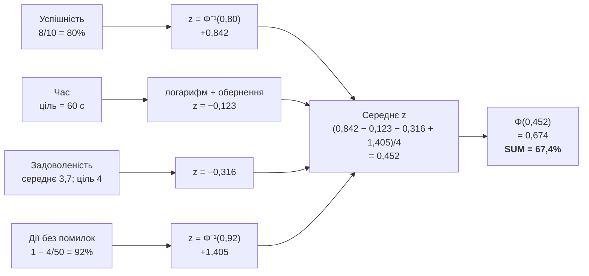
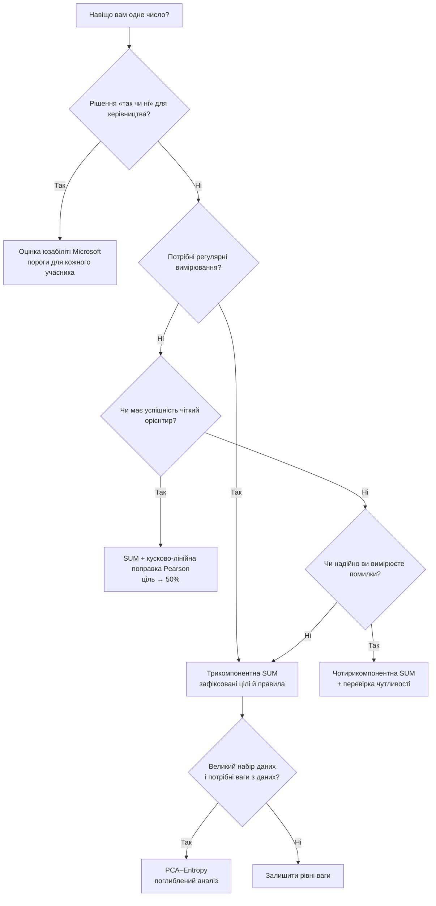

# Єдина метрика юзабіліті (SUM): як звести успішність, час і враження користувачів до одного числа — і не обманути себе

<!-- guide: {"kicker": "Дослідницький огляд", "curve": {"z": 0.452, "label": "Оформлення замовлення: SUM = 67,4%"}} -->

## Коротко про головне

**Єдина метрика юзабіліті, Single Usability Metric (SUM),** намагається одним числом відповісти на цілком людське запитання: *«Наскільки зручний цей продукт загалом?»* Проте юзабіліті складається щонайменше з кількох різних речей: чи впорався учасник із завданням, скільки часу на це витратив, скільки помилок зробив і наскільки залишився задоволеним. Класичну SUM запропонували Jeff Sauro та Erika Kindlund у 2005 році [[1](#ref-1)]. Вони спиралися на традицію ISO/ANSI, що описує юзабіліті через **результативність, ефективність і задоволеність** (effectiveness, efficiency, satisfaction): звели різнорідні показники до однієї шкали й об’єднали їх. Статтю опубліковано на конференції CHI 2005, DOI 10.1145/1054972.1055028.

Сила SUM — у простоті: таке число зручно використовувати для бізнес-рішень. Секунди не можна просто додати до оцінки 1–5 чи до 80% успішних виконань. Тому кожен показник переводять у **стандартизовану відстань від бажаного рівня** — z-оцінку, а такі величини вже можна усереднювати. У класичному описі суб’єктивні оцінки порівнюють із цільовим значенням (межею специфікації). Для часу радили логарифм і орієнтир на кшталт `3 × час експерта`, а частку успішних виконань і частку помилок перетворювали на z-еквіваленти. Потім складові усереднювали й переводили результат назад у процентиль.

Та майже кожна з цих на вигляд охайних операцій має приховану умову. У великій дослідницькій програмі Microsoft — 36 досліджень, майже 500 завдань, 13 платформ, близько 800 учасників і понад 9000 спостережень — з’ясувалося кілька речей. Помилки важко стабільно кодувати. Правило `3 × час експерта` погано працює для дуже коротких і дуже довгих завдань. Різні шкали Лайкерта мають різні смислові пороги. А підсумкове нормалізоване число часом пояснити складніше, ніж вихідні дані. Саме тому Van Waardhuizen, McLean-Oliver, Perry і Munko запропонували альтернативу — **оцінку юзабіліті** (Usability Score), описану в статті *Explorations on Single Usability Metrics* на CHI 2019 [[10](#ref-10)].

Головний висновок цього огляду:

| Варіант | Що об’єднує | Головна перевага | Головний ризик | Де я б застосовував |
|---|---|---|---|---|
| **Класична чотирикомпонентна SUM** | успішність + помилки + час + задоволеність | Найповніше втілює задум SUM | Частка помилок і ціль за часом можуть переважити інші складові й бути нестабільними | Коли для всіх чотирьох показників є надійні правила, визначені заздалегідь |
| **Трикомпонентна SUM** | успішність + час + задоволеність | Значно менше шуму від помилок | Проблеми зі складовою успішності та з ціллю за часом залишаються | Добра основа для регулярних вимірювань |
| **Практичний варіант Autodesk** | успішність + час + задоволеність, без помилок; цілі визначено емпірично | Цілі прив’язано до реального продукту | Цілі залежать від того, як побудовано вимірювання | Стабільні порівняння з року в рік |
| **Оцінка юзабіліті Microsoft** | успіх І відчуття часу І легкість І задоволеність | Дуже зрозуміла: «частка учасників, для яких усе було достатньо добре» | Жорсткі пороги, втрата градацій | Звіти для керівництва, рішення «випускати чи ні» |
| **Pearson: поправка Бернуллі** | виправляє складову успішності в SUM | Робить орієнтир для успішності явним | Ділення на нуль, коли успішність 0% або 100%; статистично дискусійна конструкція | Радше для аналізу чутливості |
| **Pearson: кусково-лінійна інтерполяція** | теж калібрує успішність відносно орієнтира | Проста, прозора; орієнтир → рівно 50% | Штучна кусково-лінійна шкала | Практична SUM, коли поріг успішності принциповий |
| **SUM із вагами PCA–Entropy, 2026** | ваги результативності, ефективності й задоволеності визначають дані | Ваги випливають зі структури даних | Значно складніша; оцінка залежить від конкретного набору даних | Великі програми вимірювань із багатьма завданнями |
| **SUMA** | додає доступність, легкість навчання, гнучкість, запам’ятовуваність тощо | Розширює саме поняття юзабіліті | Ще не стала таким усталеним готовим алгоритмом, як класична SUM | Напрям розвитку, особливо для інклюзивного дизайну |

> [!TIP]
> Для більшості практичних UX-вимірювань я б обрав **трикомпонентну SUM без автоматичної поправки Six Sigma і окремо показував би три складові**. Якщо ж критично важливо, щоб орієнтир для успішності, скажімо 78%, відповідав нейтральній точці зведеної оцінки, я б додав **кусково-лінійну поправку Pearson** як правило, зафіксоване заздалегідь. Це синтез, а не універсальна норма: Microsoft і Autodesk незалежно одна від одної відмовилися від складової помилок [[7](#ref-7), [10](#ref-10)], а Pearson показав окрему проблему з нормалізацією успішності [[11](#ref-11)].

Для звітів керівництву, де важливіше сказати *«62% учасників виконали завдання і водночас вважали його достатньо простим, швидким і приємним»*, ніж мати математично гладкий індекс, варіант Microsoft часто буде зрозумілішим за SUM.

> [!IMPORTANT]
> І нарешті: **одне число не замінює діагностики**. SUM корисна так само, як покази термометра. Але якщо температура висока, лікар однаково хоче знати причину. Тому поруч зі зведеною оцінкою завжди показуйте окремо успішність, час і задоволеність. Інакше дві зовсім різні UX-проблеми можуть дати однакову SUM. Це особливо важливо з огляду на труднощі в комунікації, про які Microsoft розповіла після багатьох років роботи з метрикою [[10](#ref-10)].


## Статистичний мінімум: що насправді роблять z-оцінки, нормалізація, ваги й агрегування

Почнімо не з формул, а з проблеми.

Уявімо три результати одного завдання:

- частка успішних виконань — **80%**;
- середній час — **63 секунди**;
- задоволеність — **3,7 з 5**.

Не можна написати:

\[
0{,}80 + 63 + 3{,}7 = 67{,}5
\]

і назвати 67,5 юзабіліті. Одиниці вимірювання різні. Це все одно що додати 5 кілометрів до 7 градусів Цельсія.

Тож спершу SUM переводить показники на **спільну мову без одиниць вимірювання**.

### Що таке стандартне відхилення

Припустімо, десятеро учасників оцінили задоволеність так:

\[
5;\;4;\;4;\;4;\;3;\;4;\;5;\;3;\;2;\;3.
\]

Середнє:

\[
\bar{x}=3{,}7.
\]

Та одного середнього замало. Треба знати, наскільки розкидані відповіді.

Для наших значень вибіркове стандартне відхилення:

\[
s\approx0{,}949.
\]

Простими словами: **типова оцінка відстоїть від середнього приблизно на 0,95 бала**.

В Excel:

```excel
=AVERAGE(D2:D11)
```

і:

```excel
=STDEV.S(D2:D11)
```

Формули в цьому огляді записано так, як їх приймає англомовний Excel: десяткова крапка, аргументи через кому. В українській локалі Excel пишіть десяткову кому, а аргументи відокремлюйте крапкою з комою.

Microsoft визначає `STDEV.S` як оцінку стандартного відхилення за вибіркою; стандартне відхилення показує, наскільки широко значення розкидані навколо середнього.

### Що таке z-оцінка

Класична формула:

\[
z=\frac{x-\mu}{\sigma}.
\]

У SUM нас часто цікавить трохи інше прочитання:

\[
z=\frac{\text{спостережене}-\text{ціль}}{SD}.
\]

Наприклад, якщо ціль для задоволеності — 4:

\[
z_{\text{зад}}=
\frac{3{,}7-4}{0{,}949}
=
-0{,}316.
\]

Читати це варто так:

> [!NOTE]
> Середня задоволеність приблизно на **0,32 стандартного відхилення нижча** за бажаний рівень.

Не варто бачити в z щось лячне. Це просто універсальна лінійка:

- `z = 0` — ми рівно на цілі;
- `z = +1` — на одне стандартне відхилення краще;
- `z = -1` — на одне стандартне відхилення гірше.

### Чому z можна перевести у відсотки

Стандартний нормальний розподіл має середнє 0 і стандартне відхилення 1. Його функція розподілу \(\Phi(z)\) перетворює z на число від 0 до 1. В Excel це робить `NORM.S.DIST(z,TRUE)`, а `NORM.S.INV(p)` виконує зворотну дію — за процентилем чи ймовірністю повертає z.

Наприклад:

\[
\Phi(0)=0{,}50.
\]

Тобто `z=0` відповідає 50-му процентилю.

\[
\Phi(1)\approx0{,}8413.
\]

А `z=1` — приблизно 84,1%.

В Excel:

```excel
=NORM.S.DIST(1,TRUE)
```

→ `0.841344746`.

Google Таблиці теж мають функції стандартного нормального розподілу й обернені до них, зокрема `NORM.S.DIST` / `NORM.S.INV` і старіші `NORMSDIST` / `NORMSINV`.

### Нормалізація і стандартизація — не одне й те саме

В UX-текстах ці слова іноді вживають довільно, але їх корисно розрізняти:

**нормалізація** — загальна ідея звести різні величини до спільної шкали;

**стандартизація** — конкретний спосіб це зробити, найчастіше через z-оцінку;

**переведення в процентилі** — перетворення z на шкалу від 0 до 1 через \(\Phi(z)\).

Наприклад:

\[
3{,}7/5;\;63\,\text{с};\;80\%
\]

після стандартизації можуть стати:

\[
-0{,}316;\;-0{,}123;\;+0{,}842.
\]

Тепер їх можна об’єднувати математично.

### Що означають ваги

Рівні ваги для трьох складових:

\[
z_{SUM}=
\frac{z_1+z_2+z_3}{3}.
\]

Це те саме, що:

\[
z_{SUM}
=
0{,}333z_1+0{,}333z_2+0{,}333z_3.
\]

Якщо успішність важливіша:

\[
z_{SUM}
=
0{,}50z_{\text{усп}}
+
0{,}25z_{\text{час}}
+
0{,}25z_{\text{зад}}.
\]

Вага буквально відповідає на запитання:

> «Яку частку голосу отримує цей показник, коли ми складаємо одне число?»

Sauro і Kindlund застосували метод головних компонент (PCA), щоб дослідити, як складові пов’язані між собою, і їхня робота підтвердила, що їх можна об’єднувати [[1](#ref-1)]. На практиці ж найчастіше беруть рівні ваги.

> [!IMPORTANT]
> Але тут є принципова річ: **рівні ваги не означають рівного впливу**.
>
> Якщо одна z-оцінка дорівнює +3, а дві інші — 0,1 і 0,2, перша складова однаково майже повністю визначить результат.

### Навіщо час логарифмують

Час на завдання майже завжди має природну нижню межу — нуль, але може мати довгий «хвіст» праворуч: більшість учасників вкладається у 20–30 секунд, а хтось один губиться й витрачає дві хвилини.

Наприклад:

\[
20;\;22;\;23;\;24;\;120.
\]

Середнє арифметичне:

\[
41{,}8\,\text{с}.
\]

Середнє геометричне, яке відповідає усередненню \(\ln(t)\):

\[
\approx31{,}1\,\text{с}.
\]

Логарифм не «викидає» повільного учасника, але робить його вплив не таким руйнівним. У класичних описах SUM радили брати натуральний логарифм часу перед стандартизацією.

У таблиці:

```excel
=LN(C2)
```

і протягнути формулу вниз.

Проте є дві зовсім різні z-оцінки, яких не можна плутати:

\[
z_{\text{ціль}}
=
\frac{x-\text{ціль}}{SD}
\]

відповідає на запитання *«наскільки ми кращі чи гірші за вимогу?»*;

\[
z_{\text{відн}}
=
\frac{x-\bar{x}}{SD}
\]

відповідає на інше запитання: *«наскільки це завдання краще чи гірше за середнє завдання в цьому наборі даних?»*

Класична SUM для часу й задоволеності орієнтується переважно на ціль, а новий підхід PCA–Entropy 2026 року стандартизує кожне завдання відносно середнього у вибірці [[14](#ref-14)]. Це суттєва різниця в тлумаченні.


## Класична SUM: формули, повний приклад і таблиця, яку можна відтворити

Класична SUM спирається на чотири складові:

\[
\text{Результативність}
\rightarrow
\begin{cases}
\text{Успішність}\\
\text{Помилки}
\end{cases}
\]

\[
\text{Ефективність}\rightarrow \text{Час на завдання}
\]

\[
\text{Задоволеність}\rightarrow\text{оцінки після завдання}.
\]

Така структура відповідає традиції ISO описувати юзабіліті через результативність, ефективність і задоволеність. Чинний стандарт ISO 9241-11:2018 будує свою модель юзабіліті саме довкола результату використання в певному контексті.

У стислому викладі Microsoft [[10](#ref-10)] класична SUM працює так. Суб’єктивні оцінки порівнюють із межею 4/5. Час логарифмують, а типовою рекомендованою межею був `час експерта × 3` [[3](#ref-3)]. Кількість помилок ділять на кількість можливостей помилитися. Успішність і частку помилок перетворюють на z-еквіваленти. Чотири складові усереднюють, а зведену z-оцінку переводять назад у процентиль.

### Навчальний набір даних

Уявімо тест оформлення замовлення в інтернет-магазині.

Експерт виконує завдання приблизно за 20 секунд. Щоб проілюструвати канонічне правило, беремо:

\[
T_{\text{ціль}}=20\times3=60\,\text{с}.
\]

Ціль для задоволеності:

\[
S_{\text{ціль}}=4/5.
\]

Припустімо також, що ми заздалегідь визначили: кожен учасник має 5 можливостей помилитися.

| Учасник | Успіх | Час, с | Задоволеність 1–5 | Помилки | Можливості помилитися |
|---|---:|---:|---:|---:|---:|
| У1 | 1 | 42 | 5 | 0 | 5 |
| У2 | 1 | 50 | 4 | 0 | 5 |
| У3 | 1 | 55 | 4 | 1 | 5 |
| У4 | 1 | 60 | 4 | 0 | 5 |
| У5 | 1 | 64 | 3 | 0 | 5 |
| У6 | 1 | 72 | 4 | 1 | 5 |
| У7 | 1 | 78 | 5 | 0 | 5 |
| У8 | 1 | 85 | 3 | 1 | 5 |
| У9 | 0 | — | 2 | 1 | 5 |
| У10 | 0 | — | 3 | 0 | 5 |

> [!WARNING]
> У цьому прикладі час рахуємо лише для тих, хто виконав завдання. Таке **правило треба зафіксувати заздалегідь**: якщо виключити невдалі спроби з розрахунку часу, виникає систематична помилка вцілілого (survivor bias), до якої ми ще повернемося.

#### Успішність виконання

\[
p_{\text{усп}}=\frac{8}{10}=0{,}80.
\]

Для успішності класична логіка не рахує:

\[
\frac{0{,}80-0{,}78}{SD}.
\]

Натомість частку переводять у її еквівалент на стандартній нормальній шкалі:

\[
z_{\text{усп}}=\Phi^{-1}(0{,}80)=0{,}8416.
\]

Excel:

```excel
=NORM.S.INV(AVERAGE(B2:B11))
```

Результат:

```text
0.841621
```

Саме цю особливість згодом розкритикує Pearson.

#### Час на завдання

Беремо натуральні логарифми:

| t | ln(t) |
|---:|---:|
| 42 | 3,7377 |
| 50 | 3,9120 |
| 55 | 4,0073 |
| 60 | 4,0943 |
| 64 | 4,1589 |
| 72 | 4,2767 |
| 78 | 4,3567 |
| 85 | 4,4427 |

Середнє логарифмів часу:

\[
\overline{\ln(t)}=4{,}1233.
\]

Вибіркове стандартне відхилення:

\[
SD_{\ln(t)}=0{,}2357.
\]

Ціль:

\[
\ln(60)=4{,}0943.
\]

Оскільки **менший час — кращий**, знак треба обернути так, щоб «більше z = краще»:

\[
z_{\text{час}}=
\frac{\ln(T_{\text{ціль}})-\overline{\ln(t)}}{SD_{\ln(t)}}.
\]

Тобто:

\[
z_{\text{час}}=
\frac{4{,}0943-4{,}1233}{0{,}2357}
=
-0{,}1228.
\]

У середньому наші учасники трохи повільніші за ціль.

У клітинці `G2`:

```excel
=IF(B2=1,LN(C2),NA())
```

а підсумок:

```excel
=(LN(60)-AVERAGE(FILTER(G2:G11,B2:B11=1)))/
 STDEV.S(FILTER(G2:G11,B2:B11=1))
```

У кейсі Autodesk теж окремо наголошено [[7](#ref-7)], що знак для часу треба обертати: менший час означає кращий UX, тоді як для задоволеності й успішності кращі більші значення.

#### Задоволеність

Маємо:

\[
\bar{S}=3{,}7
\]

і:

\[
SD_S=0{,}9487.
\]

Ціль — 4:

\[
z_{\text{зад}}=
\frac{3{,}7-4}{0{,}9487}
=
-0{,}3162.
\]

Excel:

```excel
=(AVERAGE(D2:D11)-4)/STDEV.S(D2:D11)
```

#### Помилки

Усього помилок:

\[
E=4.
\]

Можливостей помилитися:

\[
50.
\]

Частка помилок:

\[
r_e=\frac{4}{50}=0{,}08.
\]

Але що більше помилок, то гірше, тому спершу перетворимо цю частку на «частку дій без помилок»:

\[
q_e=1-r_e=0{,}92.
\]

Далі:

\[
z_e=\Phi^{-1}(0{,}92)=1{,}4051.
\]

Excel:

```excel
=1-SUM(E2:E11)/SUM(F2:F11)
```

→ `0.92`

і:

```excel
=NORM.S.INV(0.92)
```

→ `1.405072`.

Таке обернення частки помилок (1 − частка помилок) докладно розглянуто в кейсі Autodesk.

#### Зведення складових

Тепер маємо:

| Складова | z |
|---|---:|
| Успішність | +0,8416 |
| Час | −0,1228 |
| Задоволеність | −0,3162 |
| Дії без помилок | +1,4051 |

Зведена оцінка з рівними вагами:

\[
z_{SUM}
=
\frac{0{,}8416-0{,}1228-0{,}3162+1{,}4051}{4}
=
0{,}4519.
\]

У таблиці:

```excel
=AVERAGE(z_completion,z_time,z_satisfaction,z_error)
```

Переводимо назад:

\[
SUM=\Phi(0{,}4519)=0{,}6743.
\]

Тобто:

\[
\boxed{SUM\approx67{,}4\%}
\]

У таблиці:

```excel
=NORM.S.DIST(0.451920,TRUE)
```

Microsoft підтверджує цю загальну послідовність: стандартизовані складові → середнє → процентиль.

Ось увесь розрахунок на одній схемі:



> [!WARNING]
> Уже цей приклад показує приховану небезпеку: **сама лише складова помилок додала +1,405 z**, хоча задоволеність і час нижчі за ціль. Тобто «майже повна відсутність помилок» помітно підняла загальну оцінку.

### Загадкова поправка +1,5 сигми

В описах SUM, орієнтованих на Six Sigma, з’являється ще один крок, доданий постфактум [[4](#ref-4)]:

\[
z_{\text{процес}}=z_{SUM}+1{,}5.
\]

Autodesk зазначає, що Sauro і Kindlund рекомендували такий зсув [[7](#ref-7)], але сама команда Autodesk вирішила **його не застосовувати**: виробниче обґрунтування, пов’язане з довгостроковим дрейфом верстата, навряд чи переноситься на взаємодію людини з програмою.

Подивімося, чому це не косметична дрібниця.

Без зсуву:

\[
\Phi(0{,}4519)=67{,}4\%.
\]

Із поправкою +1,5:

\[
\Phi(1{,}9519)\approx97{,}45\%.
\]

Ті самі сирі дані можуть перетворитися з «67%» на «97%».

> [!WARNING]
> Тому **ніколи не пишіть просто «SUM = 97%»**, не вказавши, чи застосовано зсув на 1,5 сигми. По суті, це різні шкали.

> [!TIP]
> Моя практична порада для UX-звітів — не застосовувати зсув автоматично. Якщо організація історично ним користується, зберігайте його лише заради порівнянності в часі й чітко позначайте метод. Позиція Autodesk показує, що відмова від зсуву має задокументований практичний прецедент.


## Задокументовані модифікації: від спрощеної SUM до варіантів Microsoft, Pearson і PCA–Entropy

### Трикомпонентна SUM: без помилок

З часом Microsoft відмовилася від частки помилок як базового показника юзабіліті [[10](#ref-10)]. Автори назвали дві принципові проблеми. Перша — низька або нестабільна узгодженість між оцінювачами, коли вони класифікують помилки. Друга — неоднозначний знаменник: «а скільки взагалі було можливостей помилитися?» У статті зазначено, що Sauro теж визнавав цю проблему й пропонував трикомпонентну SUM [[9](#ref-9)].

Візьмімо наш попередній набір даних і просто приберімо `z_error` = 1,4051.

\[
z_{SUM3}
=
\frac{0{,}8416-0{,}1228-0{,}3162}{3}
=
0{,}1342.
\]

\[
SUM_3
=
\Phi(0{,}1342)
=
0{,}5534.
\]

Отже:

\[
\boxed{SUM_3=55{,}3\%}
\]

проти:

\[
\boxed{SUM_4=67{,}4\%}.
\]

Той самий тест, лише інша методична домовленість — і різниця становить **12,1 відсоткового пункту**.

Excel:

```excel
=NORM.S.DIST(AVERAGE(z_completion,z_time,z_satisfaction),TRUE)
```

> [!IMPORTANT]
> Це чудово показує, чому зведену метрику ніколи не можна сприймати як «об’єктивне число природи». Вона — **функція ваших домовленостей про вимірювання**.

### Практичний варіант Autodesk

У кейсі Autodesk команда теж відмовилася від помилок [[7](#ref-7)]: їх і можливості помилитися важко стабільно визначати. Задоволеність вимірювали трьома запитаннями за 7-бальною шкалою з ціллю 5/7. Ціль за часом визначали емпірично — як 80-й процентиль часу виконання серед достатньо задоволених учасників. Якщо успішних учасників було троє чи менше, брали запасне правило, прив’язане до ліміту часу на завдання. Зсув на 1,5 сигми не застосовували, а підсумкову z-оцінку переводили у відсотки, щоб її було легше пояснювати.

Розгляньмо спрощений приклад, який легко відтворити. Цілі вже встановлено за попереднім вимірюванням:

\[
T_{\text{ціль}}=100\,\text{с},
\qquad
S_{\text{ціль}}=5/7.
\]

Учасників восьмеро, завдання виконали семеро.

Задоволеність:

\[
6;\;5;\;5;\;6;\;4;\;5;\;6;\;4.
\]

\[
\bar S=5{,}125,\quad SD=0{,}835.
\]

Отже:

\[
z_S=
\frac{5{,}125-5}{0{,}835}
=
0{,}150.
\]

Excel:

```excel
=(AVERAGE(D2:D9)-5)/STDEV.S(D2:D9)
```

Успішність:

\[
p=7/8=0{,}875.
\]

\[
z_C=\Phi^{-1}(0{,}875)=1{,}150.
\]

```excel
=NORM.S.INV(7/8)
```

Час успішних виконань:

\[
80;\;85;\;90;\;95;\;100;\;110;\;120.
\]

\[
\bar T=97{,}143,\quad SD_T=14{,}100.
\]

Менше — краще:

\[
z_T=
\frac{100-97{,}143}{14{,}100}
=
0{,}203.
\]

```excel
=(100-AVERAGE(C2:C8))/STDEV.S(C2:C8)
```

Зведення:

\[
z=
\frac{1{,}150+0{,}150+0{,}203}{3}
=
0{,}501.
\]

\[
SUM=\Phi(0{,}501)=69{,}2\%.
\]

```excel
=NORM.S.DIST(AVERAGE(z_completion,z_time,z_sat),TRUE)
```

→ **69,2%**.

> [!NOTE]
> Важливо: це ілюстрація розрахунку *після того*, як емпіричну ціль уже встановлено. Найцінніше в модифікації Autodesk — не інша алгебра, а інший **підхід до визначення цілей**: ціль має походити з реальної програми вимірювань, а не з універсального правила `час експерта × 3`.

### Microsoft, 2019: оцінка юзабіліті замість неперервної SUM

Це найважливіша модифікація зі статті *Explorations on Single Usability Metrics* [[10](#ref-10)] — а точніше, альтернатива. Після двох з половиною років програми вимірювань Microsoft прибрала з єдиної метрики не лише частку помилок, а й виміряний час. Час залишили для прямого порівняння схожих сценаріїв, але не для універсальної зведеної оцінки: об’єктивно «добрий час» виявився надто залежним від контексту.

Microsoft залишила чотири умови для кожного учасника:

\[
\text{Успіх}=1
\]

\[
\text{Відчуття часу}\ge3
\]

\[
\text{Легкість}\ge4
\]

\[
\text{Задоволеність}\ge4.
\]

За змістом це означає:

- відчуття часу `3` = **«як і очікувалося»**;
- поріг легкості `4` = **«радше легко»**;
- задоволеність `4` = **«радше задоволений»**.

Для конкретного учасника:

\[
U_i=
I(
\text{Успіх}_i
\land
\text{Час}_i\ge3
\land
\text{Легкість}_i\ge4
\land
\text{Зад}_i\ge4
).
\]

Тобто:

\[
U_i=
\begin{cases}
1,&\text{усі умови виконано}\\
0,&\text{хоч одну не виконано}.
\end{cases}
\]

Оцінка завдання:

\[
US=\frac{\sum_i U_i}{n}.
\]

Автори описують її як **частку учасників, для яких завдання виявилося зручним**.

Приклад:

| Учасник | Успіх | Відчуття часу | Легкість | Задоволеність | Усі умови? |
|---|---:|---:|---:|---:|---:|
| У1 | 1 | 4 | 4 | 4 | 1 |
| У2 | 1 | 3 | 4 | 5 | 1 |
| У3 | 1 | 3 | 5 | 4 | 1 |
| У4 | 1 | 4 | 4 | 3 | 0 |
| У5 | 1 | 2 | 4 | 4 | 0 |
| У6 | 1 | 3 | 3 | 4 | 0 |
| У7 | 1 | 5 | 5 | 5 | 1 |
| У8 | 0 | 3 | 4 | 4 | 0 |
| У9 | 1 | 3 | 4 | 4 | 1 |
| У10 | 1 | 4 | 5 | 4 | 1 |

Усі умови виконали У1, У2, У3, У7, У9 і У10:

\[
\frac{6}{10}=60\%.
\]

\[
\boxed{\text{Оцінка юзабіліті}=60\%}
\]

Формула для рядка в Excel:

```excel
=--AND(B2=1,C2>=3,D2>=4,E2>=4)
```

протягніть до F11.

Підсумок:

```excel
=AVERAGE(F2:F11)
```

→ `0.60`.

Тут видно дивну, але важливу річ. Середні за окремими показниками:

\[
\text{Успішність}=90\%;
\]

\[
\text{Середнє відчуття часу}=3{,}4;
\]

\[
\text{Середня легкість}=4{,}2;
\]

\[
\text{Середня задоволеність}=4{,}1.
\]

Усі виглядають пристойно. Але **всім умовам одночасно** відповідають лише 60% учасників.

Це не помилка. Саме це й вимірює метрика, побудована на перетині умов.

У даних Microsoft середня задоволеність 4 відповідала приблизно 74% учасників, які поставили 4 або 5. Поріг легкості 4 так само проходили близько 74%, а відчуття часу 3 — близько 71%. Через регресійний зв’язок з успішністю автори отримали орієнтири: приблизно 86–87% успішних виконань без поправки або 79–80% зі скоригованим інтервалом Вальда (Adjusted Wald) [[5](#ref-5)].

Однак метрика вимагає, щоб кожен учасник відповідав усім умовам одночасно, тож автори застерігають: зведений поріг має інший зміст. Їхня таблиця 2 показує, що біля цілей для окремих складових єдина метрика дає приблизно 54–61%, а в тексті вони наголошують, що зведення до «так/ні» втрачає інформацію.

### Pearson: проблема частки успішного виконання

Carl Pearson опублікував свою критику у 2023 році [[11](#ref-11)] в *Proceedings of the Human Factors and Ergonomics Society Annual Meeting*. Його теза: класична SUM обробляє успішність інакше, ніж задоволеність і час. Орієнтир для успішності фактично випадає з нормалізації. Через це деякі значення успішності, нижчі за бажаний рівень, виглядають як позитивний внесок.

Припустімо:

\[
p=60\%
\]

а вимога:

\[
b=78\%.
\]

Внесок успішності в класичній SUM, виражений у процентилях:

\[
60\%.
\]

Але `60% > 50%`, хоча:

\[
60\%<78\%.
\]

Тобто зведена логіка може зарахувати 60% до «позитивного боку» стандартизованої шкали, хоча бізнес-вимогу не виконано. Саме проміжок приблизно від 0,50 до 0,78 Pearson у цьому прикладі називає особливо проблемним.

### Поправка Pearson через дисперсію Бернуллі

Автор пропонує взяти дисперсію розподілу Бернуллі:

\[
v=p(1-p).
\]

Для:

\[
p=0{,}60
\]

маємо:

\[
v=0{,}6\cdot0{,}4=0{,}24.
\]

І величина, центрована відносно цілі:

\[
z=
\frac{p-b}{v}
=
\frac{0{,}60-0{,}78}{0{,}24}
=
-0{,}75.
\]

Тоді:

\[
\Phi(-0{,}75)=0{,}2266.
\]

Тобто внесок успішності становить:

\[
\boxed{22{,}7\%}
\]

а не 60%.

Excel:

```excel
=(A2-$B$1)/(A2*(1-A2))
```

і:

```excel
=NORM.S.DIST(C2,TRUE)
```

Тут потрібне важливе застереження щодо джерела. У доступній авторській HTML-версії прикладу для `p = 0,60` проміжна дисперсія дорівнює `0,2`, а далі:

\[
(0{,}60-0{,}78)/0{,}20=-0{,}9
\]

і:

\[
\Phi(-0{,}9)=18{,}4\%.
\]

Але математично:

\[
0{,}6\cdot(1-0{,}6)=0{,}24,
\]

а не `0,20`. Офіційна анотація в SAGE підтверджує обидва запропоновані способи виправлення, а подробиці наведено в розширеній авторській версії. Тому для відтворюваного розрахунку я **не округлюю 0,24 до 0,20 перед діленням**: передчасне округлення помітно змінює результат.

Є й глибша проблема: класична z-оцінка ділить на **стандартне відхилення**, а не на дисперсію. Pearson і сам визнає, що перенесення дисперсії Бернуллі на частку успішних виконань теоретично неоднозначне, і обговорює різницю між підходом Бернуллі та біноміальним. Тому я вважаю цей варіант корисним для аналізу чутливості, але не найкращим правилом за замовчуванням.

### Кусково-лінійна інтерполяція Pearson

Другий варіант значно простіший.

Ми вимагаємо трьох речей:

\[
p=0\rightarrow\text{оцінка}=0,
\]

\[
p=b\rightarrow\text{оцінка}=0{,}5,
\]

\[
p=1\rightarrow\text{оцінка}=1.
\]

Для \(p<b\):

\[
\text{оцінка}(p)=
p\frac{0{,}5}{b}.
\]

Для \(p\ge b\):

\[
\text{оцінка}(p)=
1-(1-p)\frac{0{,}5}{1-b}.
\]

Pearson називає це поліноміальною інтерполяцією, хоча наведена функція насправді **кусково-лінійна**.

Для:

\[
p=0{,}60,\quad b=0{,}78:
\]

\[
\text{оцінка}=
0{,}60\times\frac{0{,}5}{0{,}78}
=
0{,}384615.
\]

\[
\boxed{38{,}46\%}
\]

Тобто нижче 50%, як і має бути для оцінки, що не досягла орієнтира.

Excel і Google Таблиці:

```excel
=IF(
 A2<$B$1,
 A2*0.5/$B$1,
 1-(1-A2)*0.5/(1-$B$1)
)
```

Перевірмо:

| Сира успішність | Класична SUM | Кусково-лінійна, орієнтир 78% |
|---:|---:|---:|
| 0% | 0% | 0% |
| 50% | 50% | 32,1% |
| 60% | 60% | 38,5% |
| 70% | 70% | 44,9% |
| **78%** | **78%** | **50,0%** |
| 90% | 90% | 77,3% |
| 97% | 97% | 93,2% |
| 100% | 100% | 100% |

Це перетворення не претендує на природну ймовірнісну модель. Його перевага — **калібрування за змістом**: вимога завжди стає нейтральною точкою 50%.

Щоб обережно повернути його в SUM, яка рахує в z-оцінках:

```excel
=NORM.S.INV(piecewise_score)
```

Для 38,46%:

\[
z_C\approx-0{,}2934.
\]

Тепер візьмімо завдання, схоже на приклад Pearson:

\[
S=3{,}5;\ SD_S=1{,}1;\ \text{ціль}=4
\]

і:

\[
T=75\,\text{с};\ SD_T=50;\ \text{ціль}=60\,\text{с}.
\]

Задоволеність:

\[
z_S=
\frac{3{,}5-4}{1{,}1}
=
-0{,}4545.
\]

Час, після обернення знака:

\[
z_T=
-\frac{75-60}{50}
=
-0{,}3000.
\]

Класична успішність:

\[
z_C=\Phi^{-1}(0{,}60)=0{,}2533.
\]

Класичне зведення:

\[
z=
\frac{-0{,}4545-0{,}3000+0{,}2533}{3}
=
-0{,}1671.
\]

\[
SUM=43{,}4\%.
\]

Із кусково-лінійною поправкою:

\[
z_C=-0{,}2934.
\]

\[
z=
\frac{-0{,}4545-0{,}3000-0{,}2934}{3}
=
-0{,}3493.
\]

\[
SUM=36{,}3\%.
\]

Варіант із дисперсією Бернуллі й точним значенням 0,24 дає:

\[
z_C=-0{,}75
\]

і зведену оцінку приблизно:

\[
SUM=30{,}8\%.
\]

Отже, для тих самих сирих даних:

| Обробка успішності | Внесок успішності | Підсумкова трикомпонентна SUM |
|---|---:|---:|
| Класична | 60,0% | **43,4%** |
| Pearson, кусково-лінійна | 38,5% | **36,3%** |
| Pearson, дисперсія Бернуллі | 22,7% | **30,8%** |

> [!IMPORTANT]
> Це сильне нагадування: **«SUM» без опису правила нормалізації недостатньо, щоб результат можна було відтворити**. Pearson формально показав, що спосіб обробки успішності — не дрібна технічна деталь, а джерело систематичного зсуву оцінки.

### Модифікація PCA–Entropy (2026)

У березні 2026 року Hamka, Purwanto і Wibowo опублікували у відкритому доступі варіант для онлайн-навчання [[14](#ref-14)]. Замість фіксованих рівних ваг вони пропонують гібридні ваги, які визначають самі дані, — через метод головних компонент (PCA) та ентропію. У дослідженні використано успішність виконання, помилки, час і SUS, а потім зводить їх на рівні трьох вимірів: результативності, ефективності й задоволеності.

Результативність:

\[
Eff=
CR\,(1-\text{частка помилок}).
\]

Наприклад:

\[
CR=0{,}90;\quad \text{помилки}=0{,}20
\]

\[
Eff=0{,}90\cdot0{,}80=0{,}72=72\%.
\]

Excel:

```excel
=B2*(1-C2)
```

Це цікава зміна порівняно з класичною SUM: успішність і помилки — вже не два незалежні голоси. Помилки **штрафують успішність усередині результативності**. Автори пояснюють це тим, що 100% успішних виконань із великою кількістю помилок не повинні виглядати як бездоганна результативність.

Ефективність:

\[
Effcy=
\frac{CR/\bar T}{Effcy_{max}}\times100\%.
\]

Наприклад, завдання з:

\[
CR=0{,}90;\quad T=60\,\text{с}.
\]

Сира ефективність:

\[
0{,}90/60=0{,}015.
\]

Якщо максимум серед завдань:

\[
Effcy_{max}=0{,}020,
\]

то:

\[
Effcy=0{,}015/0{,}020=75\%.
\]

У таблиці, якщо сира ефективність у `E2:E10`:

```excel
=(B2/D2)/MAX($E$2:$E$10)
```

Задоволеність вимірюють за SUS, а всі три виміри стандартизують на рівні завдань:

\[
z=\frac{x-\bar x}{SD_x}.
\]

Після PCA та ентропійного кроку автори отримують ваги:

\[
SUM_k=
Z_{sat,k}W_{sat}
+
Z_{Eff,k}W_{Eff}
+
Z_{Effcy,k}W_{Effcy}.
\]

Загальна SUM — це середнє оцінок окремих завдань.

Наприклад, для завдання «Комунікація» у статті наведено:

\[
Z_{sat}=0{,}746,
\]

\[
Z_{Eff}=0{,}698,
\]

\[
Z_{Effcy}=-0{,}558.
\]

За умовних нормованих ваг:

\[
W_{sat}=0{,}265;
\quad W_{Eff}=0{,}470;
\quad W_{Effcy}=0{,}265
\]

отримаємо:

\[
SUM_{\text{комунікація}}
=
0{,}746\cdot0{,}265
+
0{,}698\cdot0{,}470
+
(-0{,}558)\cdot0{,}265
\]

\[
=0{,}198+0{,}328-0{,}148
\]

\[
\approx0{,}378.
\]

Excel:

```excel
=SUMPRODUCT(B2:D2,$B$15:$D$15)
```

Це **ілюстрація кроку зведення**, а не точне відтворення опублікованих емпіричних ваг.

Чому я навмисно роблю це застереження? В анотації доступної версії видавця наведено ваги 0,4294 для результативності й 0,2423 для ефективності та задоволеності. Арифметично:

\[
0{,}4294+0{,}2423+0{,}2423=0{,}9140,
\]

а не 1,0, хоча подальша формула зваженої суми передбачає нормовані ваги. Тож перш ніж відтворювати метод у робочих розрахунках, перевірте повну таблицю ваг і обчислення та обов’язково зробіть контрольну перевірку:

```excel
=SUM(weight_cells)
```

Після нормування вона має дати `1.000`.

Частина з PCA значно складніша за звичайну SUM. Автори будують коваріаційну матрицю, знаходять власні значення й власні вектори, залишають перші головні компоненти, складають із навантажень матрицю рішень і лише потім обчислюють ентропійні ваги.

Ентропійний крок, якщо матриця рішень уже готова, у принципі можна відтворити в таблиці:

\[
p_{ij}=
\frac{|x_{ij}|}
{\sum_i|x_{ij}|},
\]

\[
H_j=
-\frac{\sum_i p_{ij}\ln(p_{ij})}
{\ln n},
\]

\[
d_j=1-H_j,
\]

\[
w_j=
\frac{d_j}{\sum_kd_k}.
\]

Для доданка \(p\ln p\) при `p = 0` таблиця має явно повертати 0:

```excel
=IF(B2=0,0,B2*LN(B2))
```

Проте для **розкладу на власні значення в PCA у звичайному Excel чи Google Таблицях немає такого ж зручного рішення в одній клітинці**. Тому для повного відтворення цього варіанта практичніше взяти R, Python або перевірений статистичний пакет.

Ще одна принципова зміна: це **відносна оцінка**. Якщо результативність трьох жахливих завдань дорівнює:

\[
10;\;12;\;14,
\]

то їхні z-оцінки приблизно:

\[
-1,\;0,\;+1.
\]

Завдання з `14` виглядатиме «на одне стандартне відхилення кращим» за інші, хоча результативність 14% може бути цілком неприйнятною. Це не арифметична помилка, а саме те, як працює стандартизація відносно середнього вибірки. Тому SUM із PCA–Entropy краще читати як **відносну пріоритизацію всередині набору даних**, а не як автоматичний абсолютний критерій «пройдено чи ні». Формулу стандартизації відносно вибірки явно використано в роботі 2026 року.

### SUMA: важливе, але інше за природою розширення

У 2024 році Nasr і Zahabi запропонували *Single Usability Metric that Accounts for Accessibility (SUMA)* — єдину метрику юзабіліті з урахуванням доступності [[13](#ref-13)]. Крім результативності, ефективності й задоволеності, ця модель охоплює доступність, легкість навчання, гнучкість і запам’ятовуваність, а для зменшення кількості вимірів використовує PCA. Автори прямо називають свою роботу розробкою моделі й описують подальші кроки, щоб завершити й перевірити її.

Тому я **не вигадую для SUMA універсальної формули чи фіксованих ваг**, яких джерело не встановлює як загальний стандарт. Це важливий напрям досліджень, особливо для інклюзивного дизайну, але ще не такий стабільний готовий калькулятор, як SUM чи порогова оцінка Microsoft. Вигадана «покрокова SUMA» була б менш відтворюваною, а не більше.


## Граничні випадки й збої: коли охайне єдине число починає поводитися дивно

Найцінніше в SUM починається не тоді, коли формула працює, а тоді, коли ми знаємо, **коли їй не варто довіряти**.

### Успішність рівно 0% або 100%

Класичне перетворення:

\[
z_C=\Phi^{-1}(p).
\]

Але:

\[
\Phi^{-1}(0)=-\infty
\]

і:

\[
\Phi^{-1}(1)=+\infty.
\]

В Excel:

```excel
=NORM.S.INV(1)
```

не дасть скінченного значення z, бо обернена функція нормального розподілу визначена лише для ймовірності строго між 0 і 1. Офіційна документація Excel так і визначає аргумент — як ймовірність стандартного нормального розподілу.

У малих юзабіліті-тестах це особливо абсурдно.

П’ять учасників:

\[
5/5=100\%.
\]

Це не означає «нескінченно високого юзабіліті». Це означає лише одне: **усі п’ятеро учасників, яких ми спостерігали, виконали завдання**.

Ті самі 100% при:

\[
1000/1000
\]

спираються на значно більше даних.

Тож саму лише частку не можна мовчки видавати за статистичний висновок.

Можна застосувати поправку на неперервність, наприклад:

\[
p^*=
\frac{x+0{,}5}{n+1},
\]

але це вже **не класична SUM**, а додаткове правило згладжування.

Для 5/5:

\[
p^*=
\frac{5{,}5}{6}
=
0{,}9167,
\]

\[
z\approx1{,}383.
\]

> [!TIP]
> Найправильніше тут — не ховати проблему. Зафіксуйте правило згладжування заздалегідь або показуйте успішність окремо, з її невизначеністю, і не дозволяйте нескінченності потрапити у зведену оцінку.

### Стандартне відхилення дорівнює нулю

Уявімо оцінки задоволеності:

\[
4;\;4;\;4;\;4;\;4.
\]

\[
\bar S=4,\quad SD=0.
\]

Формула:

\[
\frac{4-4}{0}
=
\frac00
\]

не визначена.

Інтуїтивно хочеться сказати: всі рівно на цілі, тож оцінка «має бути» 0.

Але тепер:

\[
5;\;5;\;5;\;5;\;5,
\]

а ціль — 4.

\[
\frac{5-4}{0}
\]

теж не визначено.

Немає природного способу сказати, «скільки стандартних відхилень» становить різниця, якщо розкиду немає взагалі.

Тобто `SD = 0` — не дрібна незручність Excel. Це означає, що стандартизувальна лінійка **зламалася**.

Перший випадок можна обробити за задокументованим правилом:

```excel
=IF(
 STDEV.S(D2:D6)=0,
 IF(AVERAGE(D2:D6)=Target,0,NA()),
 (AVERAGE(D2:D6)-Target)/STDEV.S(D2:D6)
)
```

Але якщо середнє не дорівнює цілі, я б не підставляв штучних `+999` чи `-999`. Краще позначити складову як невизначену й показати вихідний показник.

### Помилки без чіткого знаменника

Microsoft наголосила на дуже практичній проблемі [[10](#ref-10)]: «кількість можливих помилок» часом практично неможливо визначити. У ранніх рекомендаціях як зручний знаменник траплялося `помилки + 1`, і сама Microsoft називає це джерелом додаткового шуму.

Покажімо масштаб проблеми.

Одна помічена помилка.

Якщо ми заздалегідь визначили 10 можливостей помилитися:

\[
r=\frac1{10}=10\%.
\]

Частка дій без помилок:

\[
q=90\%.
\]

\[
z=\Phi^{-1}(0{,}90)=1{,}282.
\]

Якщо ж узяти наближене правило:

\[
r=\frac{1}{1+1}=50\%.
\]

\[
q=50\%.
\]

\[
z=0.
\]

**Та сама одна помилка** дає складову `+1,282` або `0` лише через домовленість про знаменник.

> [!TIP]
> Це одна з найвагоміших причин обрати трикомпонентну SUM, якщо класифікацію помилок не визначено до початку дослідження. Microsoft відмовилася від помилок саме через ненадійність і неоднозначний знаменник; Autodesk описала дуже схожий практичний досвід [[7](#ref-7)].

### Правило «час експерта × 3» ламається на обох кінцях шкали

Microsoft наводить чудову інтуїтивну ілюстрацію [[10](#ref-10)].

Якщо експерт виконує дію «Повернутися на головну» за:

\[
1\,\text{с},
\]

то:

\[
T_{\text{ціль}}=3\,\text{с}.
\]

Учасник перечитав інструкцію чи на кілька секунд замислився — і математично він уже «надто повільний», хоча інтерфейс міг бути цілком зрозумілим.

На іншому кінці:

\[
\text{експерт}=15\,\text{хв}
\]

дає:

\[
\text{ціль}=45\,\text{хв}.
\]

Але 45 хвилин навряд чи прийнятні для сценарію, який експерт проходить за 15. Це один із головних аргументів Microsoft проти універсального множника.

Тому множник має сенс лише для **достатньо однорідного класу завдань**, а не як фізичний закон юзабіліті.

### Великий розкид часу іноді означає не поганий UX, а кілька добрих шляхів

Уявімо два інтерфейси.

A:

\[
40;\;42;\;43;\;45;\;46\,\text{с}.
\]

B:

\[
25;\;30;\;45;\;70;\;80\,\text{с}.
\]

B може мати кілька цілком прийнятних способів виконання: гарячі клавіші для досвідчених і меню для новачків.

Розкид у нього більший. Якщо поріг чи нормалізація надто залежать від розкиду, B можна покарати саме за те, що він підтримує **кілька успішних стратегій**.

Microsoft окремо застерігає: правила для часу, які спираються на розкид, можуть штрафувати завдання з кількома шляхами до успіху навіть тоді, коли успішність і задоволеність високі.

### Виміряний і відчутий час — не одне й те саме

У даних Microsoft кореляція логарифма часу [[10](#ref-10)] з успішністю становила лише 0,23, із задоволеністю — 0,30, а з відчуттям часу — 0,35. Тому автори перестали використовувати сирий час на завдання в єдиній метриці й залишили його для прямих попарних порівнянь схожих сценаріїв.

Це дуже важлива для UX думка.

Учасник може провести 90 секунд:

- у приємному дослідженні інтерфейсу й сказати «було швидко»;
- або 40 секунд у плутанині й сказати «це тривало вічність».

Час за годинником і пережиті труднощі — різні поняття.

### Підписи шкали важать більше, ніж однакові цифри

На одній шкалі:

`1 Дуже повільно … 5 Дуже швидко`

можна вирішити, що поріг — 4.

На іншій:

`1 Значно повільніше, ніж очікував … 3 Як і очікував … 5 Значно швидше, ніж очікував`

значення 3 уже означає успіх.

Якщо просто усереднити дві такі шкали, `3` і `4` втрачають зрозумілий зміст.

Саме проблема словесних підписів шкали стала однією з причин, чому Microsoft перейшла до порогової метрики.

### Оцінка Microsoft «обривається» на порозі

Учасник A:

\[
\text{Успіх}=1,\ \text{Час}=3,\ \text{Легкість}=4,\ \text{Зад}=4.
\]

Оцінка:

\[
1.
\]

Учасник B:

\[
\text{Успіх}=1,\ \text{Час}=2,\ \text{Легкість}=5,\ \text{Зад}=5.
\]

Оцінка:

\[
0.
\]

Тобто зміна відчуття часу з 3 на 2 знищує всю оцінку учасника, попри чудові інші відповіді.

Ще цікавіше:

A:

\[
3;\;4;\;4
\]

і B:

\[
1;\;1;\;1
\]

обидва можуть отримати нуль за правилом «І».

Метод чудово відповідає на запитання:

> «Яка частка учасників виконала всі мінімальні вимоги?»

але дуже погано — на запитання:

> «Наскільки далеко від прийнятного був той, хто не пройшов?»

Це ціна зведення до «так/ні», і її треба приймати свідомо. Microsoft сама описує метрику як порогове поєднання двійкових умов і визнає втрату інформації.

### Поправка Бернуллі ламається на 0% і 100%

Формула:

\[
\frac{p-b}{p(1-p)}
\]

при:

\[
p=0
\]

має знаменник 0.

При:

\[
p=1
\]

так само:

\[
1\cdot(1-1)=0.
\]

Отже, ділення на нуль припадає саме на повний успіх чи повний провал, а в малих юзабіліті-тестах це зовсім не рідкість.

Кусково-лінійний метод такої вади не має:

\[
0\rightarrow0
\]

і:

\[
1\rightarrow1.
\]

Ось чому з двох поправок Pearson для робочого застосування я віддав би перевагу **кусково-лінійному перетворенню**, а варіант Бернуллі залишив би для перевірки чутливості. Pearson і сам зауважує, що формулювання Бернуллі [[11](#ref-11)] гірше розрізняє крайні частки й має теоретичну проблему вибору між розподілом Бернуллі та біноміальним.

### Однакова успішність — різна впевненість

Два дослідження:

A:

\[
3/5=60\%.
\]

B:

\[
60/100=60\%.
\]

Внесок успішності в класичній SUM:

\[
60\%
\]

в обох.

Кусково-лінійна поправка Pearson з орієнтиром 78%:

\[
38{,}46\%
\]

в обох.

Варіант Pearson із дисперсією Бернуллі теж залежить від частки, а не від \(n\), що автор прямо обговорює.

Проте наша статистична впевненість у 60/100 очевидно значно більша, ніж у 3/5.

> [!IMPORTANT]
> Отже, **точкова оцінка — не оцінка невизначеності**.

SUM і довірчий інтервал відповідають на різні запитання:

- SUM: «де наша центральна оцінка?»;
- невизначеність: «наскільки точно ми її знаємо?»

Їх не варто підміняти одне одним.

### Чотирикомпонентна SUM може надто щедро винагородити за брак помилок

Наш навчальний приклад:

\[
SUM_4=67{,}4\%.
\]

Без помилок:

\[
SUM_3=55{,}3\%.
\]

Причина:

\[
z_{\text{помилки}}=+1{,}405.
\]

Низька частка помилок підняла загальну оцінку більш ніж на 12 відсоткових пунктів.

Чи правильно це?

Якщо помилки критичні — можливо.

Якщо ж можливості помилитися визначили приблизно, ми, можливо, просто дали дуже гучний голос найменш надійному показнику.

Саме тому ваги не можна відокремлювати від **надійності вимірювання**.

### PCA–Entropy може зламати порівнянність у часі

Це випливає з методології 2026 року: там ваги визначають зі структури й розкиду конкретного набору даних через PCA та ентропію.

Звідси практична проблема.

Рік A:

\[
SUM_A=
0{,}40E+0{,}30F+0{,}30S.
\]

Рік B: алгоритм наново визначив ваги:

\[
SUM_B=
0{,}55E+0{,}20F+0{,}25S.
\]

Навіть якщо саме юзабіліті майже не змінилося, зведена оцінка може змінитися через **зміну ваг**, а не продукту.

> [!TIP]
> Це логічний висновок із того, що ваги залежать від даних, а не окреме твердження авторів. Для регулярних вимірювань варто або зафіксувати ваги після періоду калібрування, або окремо розкладати зміну на «зміну результатів» і «зміну ваг».

### Успішність може враховуватися двічі

У методі PCA–Entropy 2026 року:

\[
\text{Результативність}=CR\,(1-\text{помилки})
\]

і:

\[
\text{Ефективність}\propto CR/\text{Час}.
\]

Тобто успішність входить і в результативність, і в ефективність.

Якщо частка успішних виконань падає, вона тягне вниз **обидва** виміри.

Це може бути цілком навмисним: без успішного виконання немає ні результативності, ні ефективності. Але на практиці це означає, що успішність має більший структурний вплив, ніж можна подумати з підсумкових ваг вимірів.

> [!TIP]
> Тому перед робочим застосуванням корисно зробити аналіз чутливості: змінити успішність на ±5 відсоткових пунктів і подивитися, наскільки зрушить підсумкова оцінка.


## Порівняння методів і готові формули для таблиць

Метод найпростіше обирати не за тим, «який математично найрозумніший», а за тим, **яке запитання ви хочете поставити даним**.

| Запитання | Найприродніший метод |
|---|---|
| «Який загальний рівень виконання й сприйняття?» | Трикомпонентна SUM |
| «Чи досягли ми мінімально прийнятного UX?» | Оцінка юзабіліті Microsoft |
| «Чи правильно зведена оцінка враховує орієнтир для успішності?» | SUM + кусково-лінійна поправка Pearson |
| «Хочемо повторювати вимірювання щороку?» | Цілі, зафіксовані заздалегідь, як в Autodesk |
| «Помилки справді критичні й добре кодуються?» | Чотирикомпонентна SUM |
| «Завдань багато, і ми хочемо, щоб ваги визначали дані?» | PCA–Entropy |
| «Доступність — окремий вимір якості?» | Напрям SUMA або доступність як окремий основний показник |

Для практичної реалізації в таблиці я б структурував книгу так (назви аркушів і стовпців залишено англійською, як у формулах):

```text
RAW_DATA
  participant
  task
  success
  time
  errors
  opportunities
  satisfaction
  perceived_time
  ease

TARGETS
  satisfaction_target
  time_target
  completion_target
  scale_thresholds

TASK_SUMMARY
  completion
  mean_time
  SD_log_time
  mean_satisfaction
  SD_satisfaction
  error_rate

STANDARDIZED
  z_completion
  z_time
  z_satisfaction
  z_error
  SUM

QA
  n
  zero_SD?
  p=0_or_1?
  weights_sum_to_1?
  missing_data?
  target_version
```

Це набагато безпечніше, ніж одна величезна формула в одній клітинці.

### Формули класичної чотирикомпонентної SUM

```excel
Completion:
=AVERAGE(B2:B11)

z completion:
=NORM.S.INV(AVERAGE(B2:B11))

Log time per successful user:
=IF(B2=1,LN(C2),NA())

z time:
=(LN(TimeTarget)
 -AVERAGE(FILTER(G2:G11,B2:B11=1)))
 /STDEV.S(FILTER(G2:G11,B2:B11=1))

z satisfaction:
=(AVERAGE(D2:D11)-SatisfactionTarget)
 /STDEV.S(D2:D11)

Error quality:
=1-SUM(E2:E11)/SUM(F2:F11)

z error:
=NORM.S.INV(ErrorQuality)

Aggregate z:
=AVERAGE(zCompletion,zTime,zSatisfaction,zError)

SUM:
=NORM.S.DIST(AggregateZ,TRUE)
```

Функції `NORM.S.INV`, `NORM.S.DIST` і `STDEV.S` описано в документації Microsoft; Google Таблиці підтримують відповідні функції нормального розподілу.

### Трикомпонентна SUM

```excel
AggregateZ:
=AVERAGE(zCompletion,zTime,zSatisfaction)

SUM:
=NORM.S.DIST(AggregateZ,TRUE)
```

### Порогова оцінка Microsoft

```excel
Per user:
=--AND(
 Success=1,
 PerceivedTime>=3,
 Ease>=4,
 Satisfaction>=4
)

Task score:
=AVERAGE(UserPassRange)
```

Пороги 3/4/4 відповідають словесним підписам шкал, описаним у дослідженні Microsoft.

### Успішність із кусково-лінійною поправкою Pearson

Якщо `A2` — сира успішність, а `B1` — орієнтир:

```excel
=IF(
 A2<$B$1,
 A2*0.5/$B$1,
 1-(1-A2)*0.5/(1-$B$1)
)
```

Далі, якщо решту SUM зводять у z-оцінках:

```excel
=NORM.S.INV(piecewise_score)
```

Формули відповідають двом гілкам, які навів Pearson.

### Варіант Pearson із дисперсією Бернуллі

```excel
=(p-benchmark)/(p*(1-p))
```

а потім:

```excel
=NORM.S.DIST(z,TRUE)
```

але потрібен захист:

```excel
=IF(OR(p=0,p=1),NA(),(p-benchmark)/(p*(1-p)))
```

бо знаменник може дорівнювати нулю.

### Регулярне вимірювання за зразком Autodesk

```excel
zSuccess:
=NORM.S.INV(CompletionRate)

zTime:
=(TimeTarget-AVERAGE(SuccessfulTimes))
 /STDEV.S(SuccessfulTimes)

zSatisfaction:
=(AVERAGE(Satisfaction)-5)
 /STDEV.S(Satisfaction)

SUM:
=NORM.S.DIST(AVERAGE(zSuccess,zTime,zSatisfaction),TRUE)
```

Найважливіше тут — правила встановлення цілей: Autodesk визначала ціль за часом емпірично [[7](#ref-7)], брала ціль 5/7 для задоволеності й відмовилася і від складової помилок, і від зсуву на сигму.

### PCA–Entropy: формули після обчислення ваг

```excel
Effectiveness:
=CompletionRate*(1-ErrorRate)

RawEfficiency:
=CompletionRate/AverageTime

ScaledEfficiency:
=RawEfficiency/MAX(AllRawEfficiency)

Z:
=(Value-AVERAGE(AllTasks))
 /STDEV.S(AllTasks)

Final weighted task score:
=SUMPRODUCT(TaskZRange,WeightRange)
```

Ці кроки відповідають рівнянням публікації 2026 року [[14](#ref-14)]; щоб отримати самі ваги PCA та ентропії, потрібні додаткові матричні обчислення.

Для контролю якості додайте щонайменше:

```excel
=SUM(WeightRange)
```

очікуючи `1`;

```excel
=COUNT(DataRange)
```

для фактичного \(n\);

```excel
=STDEV.S(DataRange)
```

щоб перевірити нульовий розкид;

і окрему клітинку:

```text
METHOD_VERSION = "SUM3_PearsonPiecewise_v1"
```

Це здається бюрократією лише доти, доки через півтора року хтось не спитає:

> «Чому минулого року SUM була 71%, а після перерахунку — 64%?»

Тоді версія методики стає такою ж важливою, як версія коду.


## Як обрати варіант і не перетворити SUM на магічне число

Почати варто не з вибору формули, а з **угоди про вимірювання**.

Ще до першого учасника запишіть:

1. що вважається успіхом;
2. які спроби входять у час;
3. що робимо з вичерпаним лімітом часу чи невдачею;
4. які запитання про задоволеність ставимо;
5. які цілі;
6. як визначаємо помилки й можливості помилитися;
7. які ваги;
8. чи застосовуємо зсув на сигму;
9. як обробляємо `p=0/1`, пропущені дані та `SD=0`;
10. чи фіксуємо ваги й цілі між хвилями вимірювання.

Інакше методику можна несвідомо «підкрутити», побачивши результати.

Для **звичайного регулярного вимірювання продукту**, коли юзабіліті відстежують від релізу до релізу, найнадійніший компроміс, на мою думку, такий:

\[
\boxed{
\text{Успішність} + \text{Час} + \text{Задоволеність}
}
\]

із трьома правилами:

- не включайте помилки, якщо немає стабільної класифікації помилок і визначених можливостей помилитися;
- встановлюйте ціль за часом з огляду на предметну галузь, а не наосліп як `3 × час експерта`;
- не застосовуйте зсув на 1,5 сигми без явної історичної чи організаційної причини.

Такий вибір добре узгоджується з практичними проблемами, на які натрапили Microsoft і Autodesk.

Якщо **вимога до успішності має чіткий бізнес-зміст**, наприклад «щонайменше 78% нових користувачів мають пройти вступний сценарій (онбординг)», класичне перетворення успішності логічно незручне: 60% дають внесок 60%, хоча ціль не досягнуто. У такій ситуації я віддав би перевагу **кусково-лінійному перетворенню Pearson**, бо:

\[
0\rightarrow0,
\quad
\text{ціль}\rightarrow0{,}5,
\quad
1\rightarrow1,
\]

воно не має ділення на нуль при 0 і 1 і його дуже легко перевірити. Pearson формально обґрунтовує потребу виправити зсув в успішності, хоча й сам називає цю інтерполяцію грубим наближенням.

Якщо головна мета — **контрольна точка для керівництва, «випускати чи ні»**, і команда хоче сказати:

> «Для скількох людей досвід був водночас успішним, достатньо легким, достатньо швидким на відчуття і приємним?»

я б використав оцінку юзабіліті Microsoft.

Її формула майже не потребує статистичних пояснень:

\[
\frac{\text{учасники, які виконали всі умови}}
{\text{усі учасники}}.
\]

Це вагома перевага. Складність пояснення класичної SUM була однією з причин, чому Microsoft шукала простішу метрику [[10](#ref-10)].

Але поруч обов’язково потрібна розбивка за складовими:

| Показник | Результат |
|---|---:|
| Успішність | 90% |
| Пройшли поріг відчуття часу | 80% |
| Пройшли поріг легкості | 80% |
| Пройшли поріг задоволеності | 90% |
| Усі чотири умови одночасно | **60%** |

Інакше керівництво побачить «60%» і не знатиме, що саме виправляти.

Якщо у вас **велика дослідницька програма з десятками завдань**, багато даних і справжня причина не довіряти рівним вагам, підхід PCA–Entropy цікавий. Він намагається врахувати і структуру кореляцій (через PCA), і розкид інформації (через ентропію). Але складність різко зростає, а ваги починають залежати від набору даних. Автори 2026 року й самі визнають, що результат чутливий до припущень про нормалізацію та до вибору вимірів.

Для регулярних вимірювань я б фіксував ваги після калібрування. Інакше одночасно змінюються і продукт, і лінійка.

Якщо доступність — критична вимога, не варто ховати її всередині класичної SUM, де доступності як окремої складової немає взагалі. SUMA важлива саме тим, що додає доступність та інші якості, але стаття 2024 року все ще описує модель у розробці [[13](#ref-13)]. Поки немає стабільної перевіреної реалізації, практично безпечніше тримати доступність як окрему **контрольну точку або окремий основний показник**, ніж вигадувати для неї власну вагу всередині SUMA.

Підсумкове дерево рішень може виглядати так:



> [!IMPORTANT]
> Найважливіше правило: **ніколи не публікуйте зведену оцінку без таблиці складових**.

Добра панель показників виглядає не так:

> SUM = 63%.

А так:

| Показник | Зараз | Ціль | Тлумачення |
|---|---:|---:|---|
| Успішність | 80% | 85% | нижче цілі |
| Медіанний або середній час | 63 с | 60 с | трохи повільно |
| Задоволеність | 3,7/5 | 4/5 | нижче цілі |
| Дії без помилок | 92% | — | високо |
| **SUM** | **67,4%** | — | підсумок, а не діагноз |

Тоді зведена оцінка виконує свою справжню роль: **не замінює історію, а дає їй заголовок**.


## Підсумок: що варто запам’ятати

SUM народилася зі слушної ідеї: юзабіліті не можна чесно звести лише до задоволеності, лише до частки успішних виконань чи лише до секундоміра. Sauro і Kindlund запропонували звести [[1](#ref-1)] результативність, ефективність і задоволеність до спільної стандартизованої шкали й об’єднати їх. Так різнорідні UX-дані стали порівнянними, а організації отримали одне число для регулярних вимірювань.

Але двадцять років практики показали, що найскладніше в SUM — не формула.

Найскладніше — **визначити, що таке «добре»**.

Чи 60 секунд — це добрий час?  
Чи прийнятна одна помилка з п’яти можливих?  
Що означає задоволеність 4/5?  
Чи однаково важливі успіх і сприйняття?  
Чи мають 60% успішних виконань давати «позитивну» оцінку, якщо вимога — 78%?

Після понад 9000 спостережень Microsoft дійшла висновку [[10](#ref-10)], що складність класичної SUM заважала і поясненню результатів, і стабільності вимірювання. Її порогова метрика свідомо жертвує статистичною детальністю заради зрозумілості.

Autodesk показала інший шлях [[7](#ref-7)]: не відкидати SUM, а пристосувати цілі до реального контексту вимірювань, прибрати ненадійну складову помилок, не застосовувати зсув на сигму автоматично й подавати z у зрозумілішій формі.

Pearson знайшов ще одну тріщину [[11](#ref-11)]: класична складова успішності центрується інакше, ніж задоволеність і час, які рахують від цілі. Тому успішність, нижча за вимогу, може давати оманливо позитивний стандартизований внесок. Його кусково-лінійна поправка приваблива не тим, що вона статистично «ідеальна», а тим, що її зміст прозорий:

\[
\boxed{\text{орієнтир}=\text{нейтральна точка}}
\]

— саме цього й чекаєш від зведеної метрики, орієнтованої на ціль.

А робота 2026 року про PCA–Entropy показує [[14](#ref-14)] інший напрям розвитку: замість запитання «які ваги ми призначимо?» вона ставить запитання «які ваги випливають зі структури даних?». Для великих наборів даних це цікаво, але має свою ціну: складність, відносне тлумачення й ризик утратити порівнянність у часі.

Тож для практичного застосування я б сформулював правило так:

\[
\boxed{
\text{SUM має бути простішою за проблему, яку підсумовує, а не складнішою.}
}
\]

Для більшості UX-команд це означає **трикомпонентну SUM + таблицю складових + зафіксовані цілі**, а якщо орієнтир для успішності принциповий — ще й **кусково-лінійну поправку Pearson**. Для керівництва, якому потрібен зрозумілий робочий KPI, — **оцінку юзабіліті Microsoft**. Дослідницьким командам із великими наборами даних варто придивитися до PCA–Entropy. Помилки варто повертати у зведену оцінку лише тоді, коли команда справді вміє стабільно їх вимірювати. Цей висновок узгоджується із задокументованим досвідом Microsoft і Autodesk та з пізнішою критикою нормалізації успішності.

І, мабуть, найважливіша перевірка, перш ніж повірити будь-якій SUM:

> **Візьміть сирі дані, вручну проведіть одне завдання через усі формули й запитайте себе: чи відповідає зміст отриманої оцінки тому, що ми називаємо «добрим юзабіліті»?**

Якщо відповідь — «ні», проблема не в учасниках. Найімовірніше, проблема в лінійці, якою ми їх вимірюємо.


## Література: джерела огляду і де їх знайти

Джерела, на яких тримається цей огляд, і додаткове читання — у хронологічному порядку. Для кожного вказано, де його знайти, чи він у відкритому доступі й навіщо його читати.

<!-- references -->

1. **Sauro, J., & Kindlund, E. (2005).** *A Method to Standardize Usability Metrics into a Single Score.* Proceedings of the SIGCHI Conference on Human Factors in Computing Systems (CHI ’05), с. 401–409. ACM.

    [doi.org/10.1145/1054972.1055028](https://doi.org/10.1145/1054972.1055028) [ACM](https://dl.acm.org/doi/10.1145/1054972.1055028) [PDF автора, MeasuringU](https://measuringu.com/papers/p482-sauro.pdf) [ResearchGate](https://www.researchgate.net/publication/221516939_A_method_to_standardize_usability_metrics_into_a_single_score)

    **Доступ.** Сторінка ACM може вимагати бібліотечного чи передплатного доступу; авторська копія на MeasuringU доступна як PDF.

    **Чому варто читати.** Це основоположна стаття про SUM. Автори беруть успішність, час на завдання, помилки й задоволеність, зводять ці різнорідні величини до спільної стандартизованої шкали й показують, як отримати одну зведену оцінку юзабіліті. Аналіз чотирьох наборів даних охопив 1860 спостережень за виконанням завдань.

2. **Sauro, J., & Kindlund, E. (2005).** *Using a Single Usability Metric (SUM) to Compare the Usability of Competing Products.* Human Computer Interaction International Conference (HCII 2005), Лас-Вегас, США.

    [Сторінка на MeasuringU](https://measuringu.com/article/using-a-single-usability-metric-sum-to-compare-the-usability-of-competing-products/) [PDF автора](https://measuringu.com/papers/HCII2005_sauro_kindlund-V9.pdf) [ResearchGate](https://www.researchgate.net/publication/228613910_Using_a_single_usability_metric_SUM_to_compare_the_Usability_of_competing_products)

    **Доступ.** Авторська версія є на MeasuringU; стабільного DOI для цієї доповіді не знайдено.

    **Чому варто читати.** Якщо перша стаття відповідає на запитання «як побудувати SUM?», то ця — на запитання «що з нею робити далі». Вона показує, як порівнювати продукти за єдиною оцінкою і як SUM поводиться поруч зі звичайними сирими UX-показниками.

3. **Sauro, J., & Kindlund, E. (2005).** *How Long Should a Task Take? Identifying Specification Limits for Task Times in Usability Tests.* Human Computer Interaction International Conference (HCII 2005), Лас-Вегас, США.

    [Сторінка на MeasuringU](https://measuringu.com/article/how-long-should-a-task-take-identifying-specification-limits-for-task-times-in-usability-tests/) [PDF автора](https://www.measuringu.com/papers/hcii2005task_times.pdf) [ResearchGate](https://www.researchgate.net/publication/249910592_How_Long_Should_a_Task_Take_Identifying_Specification_Limits_for_Task_Times_in_Usability_Tests)

    **Доступ.** На ResearchGate є лише бібліографічний запис; авторський PDF — на MeasuringU.

    **Чому варто читати.** Це важлива «деталь двигуна» SUM. Стаття пояснює, як визначити межу специфікації для часу виконання, коли готового зовнішнього орієнтира немає. Саме вибір цього порога згодом став однією з головних мішеней критики SUM.

4. **Sauro, J., & Kindlund, E. (2005).** *Making Sense of Usability Metrics: Usability and Six Sigma.* Proceedings of the 14th Annual Conference of the Usability Professionals Association (UPA 2005), Монреаль, Канада.

    [Сторінка на MeasuringU](https://measuringu.com/article/making-sense-of-usability-metrics-usability-and-six-sigma/) [ResearchGate](https://www.researchgate.net/publication/228988619_Making_Sense_of_Usability_Metrics_Usability_and_Six_Sigma)

    **Доступ.** Бібліографічний запис і авторські копії є на ResearchGate та MeasuringU; DOI не знайдено.

    **Чому варто читати.** Робота пояснює, звідки в ранній SUM узялася логіка стандартизації: Sauro і Kindlund адаптували ідеї Six Sigma, щоб переводити величини з несумісними одиницями вимірювання на спільну шкалу.

5. **Sauro, J., & Lewis, J. R. (2005).** *Estimating Completion Rates from Small Samples Using Binomial Confidence Intervals: Comparisons and Recommendations.* Proceedings of the Human Factors and Ergonomics Society Annual Meeting, т. 49, вип. 24, с. 2100–2103. SAGE / Human Factors and Ergonomics Society.

    [doi.org/10.1177/154193120504902407](https://doi.org/10.1177/154193120504902407) [SAGE](https://journals.sagepub.com/doi/10.1177/154193120504902407) [PDF автора](https://measuringu.com/papers/sauro-lewisHFES.pdf)

    **Доступ.** Версія видавця може бути платною; авторська версія є на MeasuringU.

    **Чому варто читати.** Частка успішного виконання в SUM здається простою: 8 успіхів із 10 — це 80%. Але на малій вибірці така цифра дуже невизначена. Sauro і Lewis порівнюють біноміальні довірчі інтервали й радять скоригований інтервал Вальда (Adjusted Wald) як практичний варіант для малих юзабіліті-вибірок.

6. **Hornbæk, K., & Law, E. L.-C. (2007).** *Meta-analysis of Correlations among Usability Measures.* Proceedings of the SIGCHI Conference on Human Factors in Computing Systems (CHI ’07), с. 617–626. ACM.

    [doi.org/10.1145/1240624.1240722](https://doi.org/10.1145/1240624.1240722) [ACM](https://dl.acm.org/doi/10.1145/1240624.1240722)

    **Доступ.** Сторінка видавця ACM; чи відкритий повний текст, залежить від вашого доступу.

    **Чому варто читати.** Це важлива критична противага ідеї «одного числа юзабіліті». Метааналіз сирих даних із 73 досліджень виявив доволі слабкі зв’язки між результативністю, ефективністю й задоволеністю і поставив під сумнів, наскільки безпечно стискати ці аспекти в один показник.

7. **Bradner, E., & Dawe, M. (2008).** *Parts of the SUM: A Case Study of Usability Benchmarking Using the SUM Metric.* UPA International Conference, Портленд, Орегон, США.

    [PDF на Autodesk Research](https://www.research.autodesk.com/app/uploads/2023/03/parts-of-the-sum.pdf_rec468pOlvqx4atvR.pdf)

    **Доступ.** Відкритий PDF на сайті Autodesk Research.

    **Чому варто читати.** Це той самий кейс Autodesk, про який ідеться в розділі 4, і рідкісний опис того, що відбувається, коли SUM виходить із формули в реальну програму регулярних вимірювань. Автори обговорюють вибір завдань і цільових значень, відмову від частки помилок, переведення z-оцінки у зрозумілий відсоток і те, як пояснювати результати бізнес-аудиторії.

8. **Sauro, J., & Lewis, J. R. (2009).** *Correlations among Prototypical Usability Metrics: Evidence for the Construct of Usability.* Proceedings of CHI 2009, с. 1609–1618. ACM.

    [doi.org/10.1145/1518701.1518947](https://doi.org/10.1145/1518701.1518947) [ACM](https://dl.acm.org/doi/10.1145/1518701.1518947) [PDF автора](https://measuringu.com/papers/Sauro_Lewis_CHI2009.pdf) [ResearchGate](https://www.researchgate.net/publication/221517705_Correlations_among_prototypical_usability_metrics_Evidence_for_the_construct_of_usability)

    **Доступ.** Сторінка видавця ACM; на ResearchGate є відкрита повнотекстова копія.

    **Чому варто читати.** По суті, це відповідь на критику слабких кореляцій. На базі з 90 юзабіліті-тестів, 2286 учасників і 1034 завдань автори знайшли сильніші кореляції на рівні завдань. За допомогою PCA та факторного аналізу вони показали, що просте незважене поєднання показників може мати статистичне підґрунтя, але результат суттєво залежить від рівня агрегування даних.

9. **Sauro, J. (2012).** *10 Things to Know about the Single Usability Metric (SUM).* MeasuringU.

    [measuringu.com/SUM](https://measuringu.com/SUM/)

    **Доступ.** Практична вебстаття у відкритому доступі.

    **Чому варто читати.** Це найзручніший місток від академічної статті до щоденної роботи. Sauro просто пояснює трикомпонентну й чотирикомпонентну SUM, нормалізацію часу й задоволеності, переведення оцінок у процентилі й наводить наскрізний приклад: складові 80%, 60%, 61,7% і 77,3% дають SUM 69,75%.

10. **Van Waardhuizen, M., McLean-Oliver, J., Perry, N., & Munko, J. (2019).** *Explorations on Single Usability Metrics.* CHI Conference on Human Factors in Computing Systems Extended Abstracts (CHI ’19 Extended Abstracts), кейс CS29, 8 с. ACM.

    [doi.org/10.1145/3290607.3299062](https://doi.org/10.1145/3290607.3299062) [ACM](https://dl.acm.org/doi/10.1145/3290607.3299062) [ResearchGate](https://www.researchgate.net/publication/332774221_Explorations_on_Single_Usability_Metrics)

    **Доступ.** На момент перевірки на ResearchGate була відкрита повнотекстова копія; офіційний запис — на ACM.

    **Чому варто читати.** Мабуть, найважливіше практичне продовження класичної SUM. Команда Microsoft підсумувала приблизно 2,5 року регулярних вимірювань: 36 досліджень, майже 500 завдань, 13 платформ, близько 800 учасників і понад 9000 спостережень. Після цього вона прибрала зі зведеної оцінки помилки й сирий час на завдання та запропонувала простішу порогову метрику юзабіліті.

    Ключова зміна в тому, що кожна складова стає простим «пройшов поріг / не пройшов». Для конкретного учасника й завдання загальна оцінка дорівнює 1, лише якщо учасник виконав завдання і його суб’єктивні оцінки подолали задані пороги. Середнє таких значень 0 і 1 за учасниками й дає частку людей, для яких завдання виявилося зручним.

11. **Pearson, C. J. (2023).** *A Completion Rate Conundrum: Reducing Bias in the Single Usability Metric.* Proceedings of the Human Factors and Ergonomics Society Annual Meeting, т. 67, вип. 1, с. 1407–1411. SAGE.

    [doi.org/10.1177/21695067231194328](https://doi.org/10.1177/21695067231194328) [SAGE](https://journals.sagepub.com/doi/10.1177/21695067231194328) [Пояснення автора](https://carljpearson.com/the-single-usability-metric-sum-a-completion-rate-conundrum/)

    **Доступ.** На SAGE стаття платна; розгорнуте пояснення автора доступне вільно.

    **Чому варто читати.** Pearson знаходить дуже конкретну асиметрію класичної формули. Час і задоволеність оцінюють відносно меж специфікації через стандартизацію, а частка успішного виконання потрапляє в SUM фактично як є. Через це успішність між 50% і бажаним орієнтиром може виглядати «позитивною», хоча ціль ще не досягнуто.

    Автор пропонує два способи виправлення: стандартизацію з дисперсією Бернуллі та кусково-лінійну (поліноміальну) інтерполяцію, за якої заданий орієнтир для успішності примусово відповідає нейтральній точці SUM — 50%.

12. **Albert, W., & Tullis, T. (2022).** *Measuring the User Experience: Collecting, Analyzing, and Presenting UX Metrics* (3-тє вид.). Morgan Kaufmann / Elsevier, 384 с. Розділ 9: Combined and Comparative Metrics. ISBN 978-0-12-818080-8.

    [Сторінка видавця](https://www.educate.elsevier.com/book/details/9780128180808) [doi.org/10.1016/B978-0-12-818080-8.00009-1](https://doi.org/10.1016/B978-0-12-818080-8.00009-1)

    **Доступ.** Комерційне видання; повний текст зазвичай потребує купівлі або бібліотечного доступу.

    **Чому варто читати.** Це не книжка лише про SUM, а широка практична карта UX-показників. Особливо корисний розділ про комбіновані й порівняльні показники: він дає змогу побачити SUM не як «єдино правильну формулу», а як один із кількох способів стиснути багатовимірні UX-дані в підсумковий показник.

13. **Nasr, V., & Zahabi, M. (2024).** *Development of A Single Usability Metric that Accounts for Accessibility (SUMA).* 2024 AHFE International Conference on Human Factors in Design, Engineering, and Computing.

    [doi.org/10.54941/ahfe1005655](https://doi.org/10.54941/ahfe1005655) [ResearchGate](https://www.researchgate.net/publication/385647438_Development_of_A_Single_Usability_Metric_that_Accounts_for_Accessibility_SUMA)

    **Доступ.** На ResearchGate повний текст доступний лише на запит.

    **Чому варто читати.** SUMA розширює саму ідею зведеної оцінки юзабіліті й ставить доступність у центр моделі. Автори розглядають сім вимірів — ефективність, результативність, задоволеність, доступність, легкість навчання, гнучкість і запам’ятовуваність — і використовують PCA, щоб зменшити кількість вимірів.

14. **Hamka, M., Purwanto, P., & Wibowo, A. (2026).** *A Hybrid Principal Component Analysis–Entropy Approach to Balanced Weighting in Single Usability Metric for E-Learning Evaluation.* Ingénierie des Systèmes d’Information, т. 31, № 3, с. 931–948.

    [doi.org/10.18280/isi.310324](https://doi.org/10.18280/isi.310324) [Сторінка видавця, IIETA](https://iieta.org/Journals/ISI/Archive/Vol-31-No-3-2026)

    **Доступ.** Відкритий доступ; видавець надає повний текст у HTML і PDF.

    **Чому варто читати.** Новіше розширення SUM, яке береться за іншу проблему — ваги складових. Замість автоматичного припущення, що всі показники важать однаково, автори поєднують PCA й ентропійне зважування, щоб урахувати і структуру кореляцій, і інформативність окремих показників.
